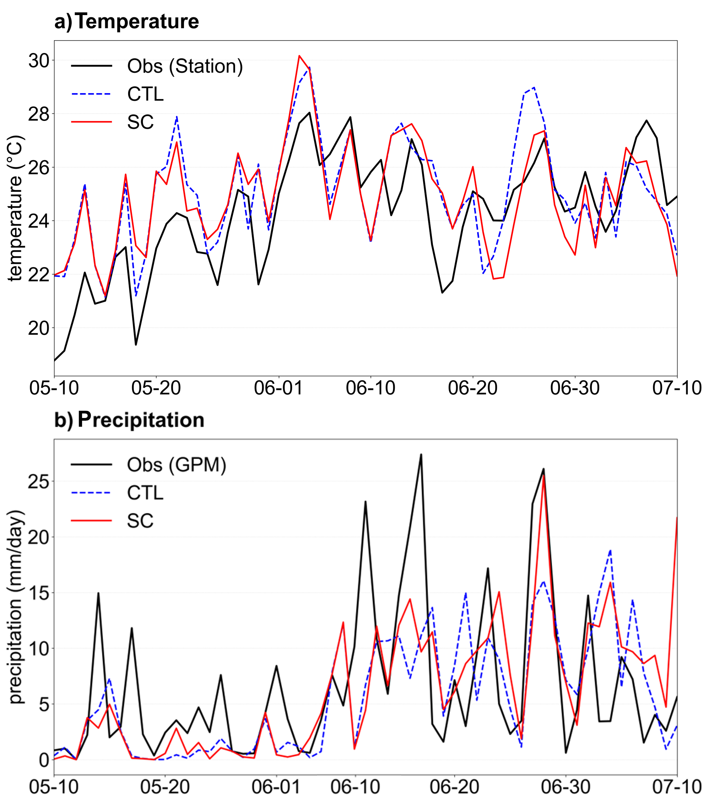
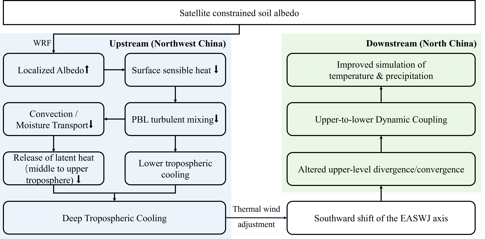

<!-- markdownlint-disable MD013 MD025 -->

# Nonlocal atmospheric response to satellite-constrained soil albedo in Northwest China improves climate simulations of North China

Jinyan Chen¹², Kai Li¹, Li Dan¹, Jiangfeng Wei³, Wei Pan¹, Fuqing Yang¹, Peng Zhou⁴, Liwen Xing¹, Long Zhao⁵, and Hui Zheng¹

¹Institute of Atmospheric Physics, Chinese Academy of Sciences, Beijing 100029, China

²University of Chinese Academy of Sciences, Beijing 101408, China

³School of Atmospheric Sciences, Nanjing University of Information Science and Technology, Nanjing, China

⁴Institute of Disaster Risk Science, Beijing Normal University, Beijing 100875, China

⁵School of Geographical Sciences, Southwest University, Chongqing 400715, China

Corresponding author: Hui Zheng (<hzheng_iap@outlook.com>)

# Key Points {-}

- Upstream bare-soil albedo is identified as a critical but overlooked source of model uncertainty for simulating downstream weather
- Correcting arid albedo bias reduces local sensible heating, triggering deep tropospheric cooling that dynamically modulates the westerly jet
- This remote atmospheric teleconnection alters vertical motion, improving simulations of downstream temperature and precipitation

# Abstract {-}

North China is vulnerable to late-spring to early-summer warm and dry conditions that threaten winter wheat production, yet the contribution of upstream soil albedo errors to simulating these events remains unexplored. Here we show that satellite-constrained soil albedo parameters over Northwest China substantially improve Weather Research and Forecasting Model simulations of the 2020 warm and dry period in North China. The albedo correction increases effective soil albedo over arid Northwest China, reducing net shortwave absorption and sensible heating and inducing deep tropospheric cooling through boundary layer and cloud microphysical processes. This cooling shifts the upper-level westerly jet southward over Northwest to North China, altering the spatial pattern of upper-level divergence and convergence in a way that improves the simulation of surface temperature and precipitation. These results identify an overlooked upstream source of model error and demonstrate that constraining dryland soil albedo with satellite observations improves simulations of downstream temperature and precipitation.

# Plain Language Summary {-}

North China experienced warm and dry conditions in early summer 2020, with both little rainfall and unusually high temperatures. Simulating such events is difficult because weather and climate models can contain errors not only in the affected region but also in far-upstream areas that influence the atmosphere downstream. In this study, we used satellite observations to correct how much sunlight bare soil reflects in the drylands of Northwest China. This property is called soil albedo. After this correction, the model absorbed less solar energy over Northwest China and released less heat from the land surface into the atmosphere. That cooling extended upward through the atmosphere and shifted the high-altitude westerly jet southward, altering the spatial pattern of upper-level winds over North China. Where the adjusted circulation produces sinking air, conditions become warmer and drier; where it produces rising air, conditions become cooler and wetter. The net effect is an improved simulation of the spatial pattern and temporal evolution of temperature and precipitation in North China. These results show that an overlooked land-surface bias in arid Northwest China can influence weather and climate far downstream, and that satellite observations can help correct these remote model errors.

# Introduction

North China is a major winter wheat production region vulnerable to late-spring to early-summer drought during critical growth stages [@zeng2026CEE]. Concurrent precipitation deficits and anomalous warmth can rapidly deplete soil moisture, impair crop development, and increase fire risk. Previous studies have attributed these droughts to large-scale drivers, including East Asian circulation variability and sea surface temperature anomalies in the Pacific and Indian Oceans [@zhang2015JC; @yang2005CJG], and have highlighted the importance of local land-atmosphere interactions in drought development and simulation [@zhang2024JGRAb]. Remote upstream land-surface forcing can also influence the climate of North China through anomalous atmospheric circulation [@ding2009IJC]. For example, sensitivity experiments have shown that perturbations in bulk surface albedo over the Tibetan Plateau affect the climate of North China [@lu2021JC; @sooraj2019CD; @smyth2021JC], and diagnostic analyses of reanalysis data have identified a statistical relationship between enhanced spring sensible heating in Northwest China and persistent summer drought in North China [@zhou2012CJAS; @huang2013CJAS; @huang2003CJAS].

Surface albedo is a fundamental land-surface parameter that controls the absorption of solar radiation and thus the energy available for turbulent and radiative exchange [@henderson-sellers1983RG; @dickinson1983AiG]. Previous numerical studies have examined its climate effects by applying idealized perturbations to bulk surface albedo [@lu2021JC; @sooraj2019CD; @smyth2021JC; @myhre2005GRL] or by directly replacing bulk albedo with satellite observations [@meng2018ERL; @myhre2005GRLa]. However, these approaches are not designed to resolve the detailed land-atmosphere interactions that arise when albedo is modified as a soil-specific parameter coupled to evolving model states. By modifying bulk albedo without distinguishing its physical source—such as snow, soil, or vegetation—they break the dynamic coupling between surface albedo and evolving model states, including soil moisture. Furthermore, both the aforementioned historical statistical analyses and early numerical simulations may be constrained by coarse-resolution model grids. Consequently, they could not fully resolve the fine-scale vertical diabatic heating structures, such as planetary boundary layer turbulent mixing and cloud microphysical processes, that physically construct the vertical bridge linking upstream surface anomalies to the free troposphere. Evaluating these intricate land-atmosphere interactions requires a process-oriented diagnostic framework utilizing high-resolution, convection-permitting modeling.

In arid and sparsely vegetated regions, soil albedo strongly regulates sensible heating and boundary layer development [@albertson1995WRR; @ma2011BM]. Northwest China is representative of such arid environments. To address the limitations of the bulk-albedo perturbation approaches described above, @ma2025SCES recently used satellite-constrained soil albedo parameters over the Tibetan Plateau and showed improved local model performance. Northwest China likewise lies upstream of North China along the midlatitude westerly jet and exhibits strong land-atmosphere coupling. However, it remains unclear whether observationally constrained soil albedo parameters over Northwest China can improve simulations of downstream anomalies in North China and, if so, through what mechanisms. We hypothesize that soil albedo changes in arid Northwest China can trigger deep tropospheric cooling or warming, which shifts the upper-level westerly jet via thermal wind adjustment and thereby alters downstream temperature and precipitation in North China. Understanding this nonlocal feedback is important for improving the simulation of regional climate extremes over the East Asian monsoon transition zone.

Here we investigate this question using the 2020 late-spring to early-summer period in North China as a test case. During this period, North China experienced recurrent drought in mid- to late April and again from mid-May to early June, with precipitation deficits coinciding with extreme heat: the earliest regional heatwave since 1961 occurred on May 1–9, and an intense heat event in early June pushed temperatures above 40°C locally, together impairing winter wheat growth [@DaiTanLong2021Qi]. This specific 2020 period offers an ideal synoptic case study because it represents a critical seasonal transition phase during which the East Asian Subtropical Westerly Jet (EASWJ) undergoes latitudinal migrations directly across our upstream and downstream study regions, rendering the downstream climate highly sensitive to upstream thermal disturbances. We conduct paired experiments over China with the Weather Research and Forecasting (WRF) model, one with default soil albedo parameters (CTL) and the other with MODIS (Moderate Resolution Imaging Spectroradiometer)-constrained soil albedo parameters (SC). We show that the constrained soil albedo exerts its strongest effects over arid Northwest China, with a minor contribution from the western Tibetan Plateau, triggering a nonlocal circulation response that improves the simulation of temperature and precipitation in North China. These results underscore the importance of constraining upstream dryland land-surface parameters for regional climate simulation during the pre-monsoon to early-monsoon transition in North China.

# Data and Methods

## Regional Model and Configuration

We use the Weather Research and Forecasting (WRF) model version 4.3.2 [@skamarock2021] coupled with the Noah-MP land surface model [@niu2011JGRA]. The modeling domain covers China and adjacent regions at 3-km horizontal grid spacing (Figure 1a), allowing deep convection to be resolved explicitly rather than parameterized. By avoiding the empirical assumptions inherent in conventional cumulus parameterization schemes at this convection-permitting scale, the model can better capture the fine-scale localized convective thermals, boundary-layer structural evolutions, and explicit hydrometeor interactions over complex land surfaces. The model has 55 vertical levels extending to 50 hPa, with enhanced resolution in the planetary boundary layer to better capture near-surface thermal structure and vertical mixing.

The physical parameterization suite includes Thompson microphysics [@thompson2004MWR], the Rapid Radiative Transfer Model for General Circulation Models (RRTMG) longwave and shortwave radiation schemes [@iacono2008JGRA], and the Mellor–Yamada–Nakanishi–Niino planetary boundary layer scheme [@nakanishi2009JMSJ]. Initial and 3-hourly lateral boundary conditions are derived from the ERA5 reanalysis at 0.25° resolution [@hersbach2020QJRMS].

## Experimental Design

In Noah-MP, soil albedo is parameterized as a function of soil moisture and two parameters: dry-soil albedo and wet-soil albedo. In the control experiment (CTL), these parameters are set to 0.235 and 0.135, respectively, and applied uniformly across the domain. In the sensitivity experiment (SC), they vary spatially among 20 soil albedo (soil color) classes, consistent with those used in the Community Land Model [@lawrence2007JGR]. The soil color class at each grid cell is identified by evaluating all 20 classes in offline Noah-MP simulations driven by the Global Land Data Assimilation System and selecting the class that best matches the bulk surface albedo observed by MODIS MCD43C3. Further details of the calibration are provided by @ChenJinYan2024C; these constrained parameters were previously used by @ma2025SCES and improved coupled land-atmosphere simulations over the Tibetan Plateau.

In this study, we apply an additional filter that retains only grid cells where the constrained dry- or wet-soil albedo parameter increases by more than 0.04 relative to CTL, corresponding to the uncertainty of the MODIS albedo product; at all other grid cells, SC uses the same parameters as CTL. This filter isolates robust upstream forcing and focuses the analysis on its remote impact on North China. Both CTL and SC are initialized on April 1, 2020, with April 1 to May 9 treated as spin-up. The analysis period spans May 10 to July 10, during which the East Asian Subtropical Westerly Jet typically resides over North China. Because each experiment consists of a single realization, the results should be interpreted as a process-based demonstration.

## Observations and Evaluation Metrics

Model performance was rigorously validated using multisource observations. Surface air temperature (2-m) was evaluated against daily observations from the China Meteorological Administration (CMA) station network, which underwent strict quality control and data consistency checks. Precipitation was assessed using the Global Precipitation Measurement (GPM) Integrated Multi-satellitE Retrievals (IMERG) product. This satellite-based high-resolution precipitation product has been extensively validated across East Asia, proving its exceptional capacity to realistically capture the intra-seasonal variability and spatial distribution of precipitation events.

To ensure a consistent grid-to-grid comparison for precipitation, the 3-km WRF output was regridded to the 0.1° GPM IMERG grid using a conservative remapping method. This conservative remapping approach preserves the area-integrated total precipitation mass, preventing unphysical interpolation errors during the comparison between high-resolution model fields and grid-scale observations. Evaluation metrics include the mean bias, temporal and spatial correlation coefficients (R), and root-mean-square error (RMSE). Regional averages and evaluation metrics were calculated over the North China target region (112–125°E, 31–39°N) to quantify the downstream impacts of the upstream albedo forcing.

# Results

## Local Surface Forcing and Energy Budget

The satellite-constrained simulation increases both dry- (Figure S1a) and saturated- (Figure S1b) soil albedo predominantly over Northwest China, with a smaller contribution from the Tibetan Plateau (black outline in Figure 1b). This albedo increase directly reduces net shortwave radiation at the surface (Figure 1c). In response, the surface cools and emits less upward longwave radiation, so that net longwave radiation increases (Figure 1d). Although this longwave increase partially offsets the shortwave deficit, net radiation still exhibits a substantial and widespread decrease. Because the forcing region is highly arid (Figure S1c), the surface energy partition is heavily skewed toward sensible heating; the reduction in net radiation is therefore almost entirely balanced by a corresponding decrease in sensible heat flux (Figure 1e), while latent heat flux remains largely unaffected due to limited moisture availability (Figure 1f).

Although the albedo forcing is confined to Northwest China and the Tibetan Plateau (black outline in Figure 1), discernible surface energy budget anomalies emerge downstream over North China (green box in Figure 1). Because no soil parameters were altered in these downstream regions (Figure S1a and S1b), these remote flux perturbations over North China cannot be explained by local land-surface modifications. Instead, these pronounced downstream anomalies provide the first direct macro-scale evidence that the localized upstream dryland cooling has systematically triggered a large-scale atmospheric teleconnection, shifting wind fields and weather patterns far from the forcing source. This clearly motivates our subsequent and detailed investigation into the three-dimensional atmospheric bridge.

![**Figure 1.** Topographic map and spatial anomalies of surface energy budget components induced by satellite-constrained soil albedo. (a) Terrain height of the WRF modeling domain. b–f Spatial distributions of the mean differences between the satellite-constrained simulation (SC) and the control simulation (CTL) (SC minus CTL) from May 10 to July 10, 2020, for: (b) simulated soil albedo, (c) net shortwave radiation, (d) net longwave radiation, (e) sensible heat flux, and (f) latent heat flux. The black polygons delineate the upstream forcing regions (primarily Northwest China and the Tibetan Plateau) where soil albedo parameters were constrained by MODIS observations. The green box highlights the downstream North China region analyzed for nonlocal atmospheric responses. All flux anomalies are expressed in W m⁻².](fig/Figure01.png)

## The Vertical Profile

To identify the atmospheric bridge that connects upstream albedo perturbations to downstream responses, we first analyze how surface energy anomalies propagate into the free atmosphere over the forcing region. A longitude-altitude cross-section averaged over 30–50°N reveals that the reduced sensible heat flux cools the entire tropospheric column over the forcing region (Figure 2a). This temperature deficit extends from the surface up to the upper troposphere (\~200 hPa), with the most pronounced cooling concentrated in the mid-to-lower layers. Heat budget analysis averaged over this region indicates that the deep cooling is primarily driven by local diabatic processes rather than temperature advection, which remains weak (Figure 2c).

Partitioning the diabatic heating reveals a distinct vertical structure, reflecting the different physical processes governing the heat budget. In the WRF model, total diabatic heating is decomposed into contributions from the planetary boundary layer (PBL) scheme, cloud microphysics, and radiation. Cooling in the lower troposphere (below 600 hPa) is dominated by planetary boundary layer (PBL) mixing. This term represents the vertical redistribution of heat driven by surface sensible heating and turbulent mixing. The reduced surface sensible heating suppresses the upward transport of turbulent kinetic energy, resulting in a measurably shallower PBL (Figure S2) and a corresponding reduction in the vertical heat flux, which manifests as a cooling anomaly in the lower layers.

In contrast, the cooling in the middle to upper troposphere (above 500 hPa) is primarily maintained by cloud microphysical processes (Figure 2b), which in the WRF model context represents the latent heat exchange associated with water phase changes. As the weakened surface sensible heating suppresses local convection and vertical moisture transport, the availability of water vapor in the mid-to-upper layers decreases (Figure S3). This moisture deficit leads to a reduction in condensation and deposition processes, which are dominant heat sources for the upper atmosphere. Notably, shortwave and longwave radiation play only a minor role in the total diabatic budget.

This contrasts with findings over the Southern Great Plains, where higher albedo induced lower-tropospheric warming via atmospheric radiative heating [@park2010JAS]; in the arid Northwest China, such radiative heating is weak, allowing turbulent cooling to dominate. Together, these results confirm that the surface anomaly is efficiently transported upward through turbulent and microphysical processes, constructing a vertical bridge to the large-scale circulation.

![**Figure 2.** Vertical structure of tropospheric cooling and diabatic heating components over the Northwest China forcing region. (a) Longitude-altitude cross-section (averaged over 30°N–50°N) illustrating the vertical extent of the mean differences (SC minus CTL) in temperature (shading; K), geopotential height (contours; gpm), and wind vectors (m s⁻¹). (b) Area-averaged vertical profiles of local diabatic heating components over the upstream forcing region, including contributions from the planetary boundary layer (PBL) mixing, cloud microphysics, and longwave (LW) and shortwave (SW) radiation. (c) Comparison of the region-averaged total local diabatic heating rate with horizontal advection-induced heating and vertical motion-induced heating.](fig/Figure02.png)

## Upper-level Circulation Adjustment

The deep cooling produces a negative geopotential height anomaly at 200 hPa over the forcing region, with a maximum reduction of approximately 20 gpm (Figure 3a). This cold-core anomaly at high altitudes induces a localized cyclonic circulation adjustment around the cooling center. According to the thermal wind relationship, the altered meridional temperature gradient modulates the East Asian Subtropical Westerly Jet (EASWJ). Specifically, the localized thermal forcing leads to a southward shift of the jet axis, weakening its northern branch and strengthening its southern branch (Figure 3a).

North China lies at the southern edge of the EASWJ, where the jet shift exerts a direct dynamical influence. The associated velocity potential and divergent wind anomalies indicate that the remote response is expressed mainly through upper-level circulation adjustment over North China (Figure 3b), with the spatial pattern of upper-level divergence and convergence exerting a direct influence on lower- and mid-tropospheric vertical motion (Figure 3c–d).

Furthermore, the stability of the low-level monsoon flow supports the conclusion that the response is a localized adjustment rather than a broad reorganization of the East Asian Summer Monsoon (EASM) system (Figure 3d). This indicates that the albedo-induced forcing influences downstream climate through a specific nonlocal pathway centered on jet-stream adjustment, without requiring fundamental changes in the monsoon system\'s structure.

![**Figure 3.** Large-scale circulation adjustment and modulation of the East Asian Subtropical Westerly Jet (EASWJ). All panels show the mean differences between the satellite-constrained (SC) and control (CTL) simulations (SC minus CTL) for the period from May 10 to July 10, 2020. (a) Anomalies in 200 hPa geopotential height (shading; gpm) and wind vectors (m s⁻¹). The solid and dashed blue lines represent the EASWJ axis (30 m s⁻¹ isotach) for the CTL and SC experiments, respectively. (b) Anomalies in 200 hPa divergence (shading; 10⁻⁶ s⁻¹) and wind speed (contours; m s⁻¹). (c), (d) Multi-level responses in the c middle (500 hPa) and d lower (850 hPa) troposphere, showing wind vector differences (arrows; m s⁻¹) and vertical velocity anomalies (Δw; cm s⁻¹](fig/Figure03.png)

## Impacts on Downstream Climate

The surface temperature and precipitation response over North China exhibits physical consistency with the upper-level circulation adjustments described previously. Specifically, upper-level convergence corresponds to localized surface warming and precipitation reduction, whereas upper-level divergence aligns with surface cooling and precipitation enhancement (Figure 4d, h).

Evaluation against CMA station observations shows that the satellite-constrained (SC) simulation more accurately captures the spatial pattern and temporal evolution of temperature and precipitation anomalies during the study period, with reduced root-mean-square error (RMSE) and improved correlation (Figure 5). For surface air temperature, the SC simulation reduces the RMSE from 3.13°C to 2.99°C and increases the mean temporal correlation from 0.60 to 0.62. For precipitation, the SC simulation mitigates the systemic dry bias, with the regional mean bias improving from −0.81 mm day⁻¹ to −0.04 mm day⁻¹, and the RMSE decreasing from 20.10 mm day⁻¹ to 19.76 mm day⁻¹ (Figure 4). The spatial correlation for precipitation improves from 0.78 to 0.81. The improvements in downstream temperature simulations are statistically significant at the 95% confidence level (p<0.05).

The magnitude of improvement is greater during the later sub-period (June 15–July 10), when the jet typically resides over North China and is more directly influenced by upstream circulation changes (Figure 6). During the earlier sub-period (May 10–June 15), the jet migrates northward and the improvement is relatively smaller but still evident. These results demonstrate that satellite-constrained soil albedo over Northwest China improves the simulation of temperature and precipitation in North China through the nonlocal circulation adjustment described above.

![**Figure 5.** Statistical evaluation of surface air temperature and precipitation simulation performance over North China. Temperature is validated against CMA station observations, and precipitation is validated against GPM IMERG data. (a)–(c) Metrics for daily mean surface air temperature: (a) root-mean-square error (RMSE; ℃), (b) mean bias (BIAS; ℃), and (c) temporal correlation coefficient (R). (d)–(f) Metrics for daily precipitation: (d) RMSE (mm day⁻¹), (e) mean bias (BIAS; mm day⁻¹), and (f) temporal correlation coefficient (R).](fig/Figure05.png)

# Conclusions

The results presented in this study demonstrate that satellite-constrained soil albedo over the arid region of Northwest China improves the skill of WRF simulations for both temperature and precipitation in North China. This improvement is particularly evident during the late-spring to early-summer period (May to July), a critical transition season when the East Asian monsoon system is developing and the EASWJ resides directly over the North China region.

Our diagnostic analysis confirms that this enhancement is not a localized effect but is driven by a nonlocal circulation response. The higher satellite-derived soil albedo reduces net shortwave radiation and surface sensible heating over the dryland forcing region, which in turn induces a deep tropospheric cooling through the coupling of boundary layer turbulence and microphysical processes. This upstream thermal anomaly forces a southward shift of the EASWJ axis via thermal wind balance, thereby modulating the spatial distribution of upper-level divergence and vertical motion over the downstream North China region. This physical link mitigates the biases in surface temperature and precipitation in control simulations (summarized in Figure 7).

These findings highlight the importance of constraining upstream land-surface parameters, such as soil albedo, to improve the simulation of downstream weather extremes. This underscores the potential for satellite-based model parameter constraints to identify and mitigate sources of model error in remote areas that have notable consequences for regional climate simulation. However, limitations of this study should be recognized. Because this analysis focuses on a single year, the results should be interpreted as a process-based event study; future work with multi-year ensembles is needed to assess climatological generality.

# Acknowledgements {-}

This study was jointly supported by the National Key Research and Development Program of China (Grant No. 2023YFF0805501), the National Natural Science Foundation of China (grant 42275178), Strategic Priority Research Program of the Chinese Academy of Sciences (XDB1660103) and the National Key Scientific and Technological Infrastructure project "Earth System Numerical Simulation Facility" (EarthLab) (2025-EL-PT-001061).

# Open Research {-}

The ERA5 reanalysis data used in this study were obtained from the Copernicus Climate Change Service (C3S) Climate Data Store (<https://doi.org/10.24381/cds.adbb2d47> and <https://doi.org/10.24381/cds.bd0915c6>). MODIS albedo products (MCD43C3) were retrieved from the NASA Land Processes Distributed Active Archive Center (LP DAAC) (<https://doi.org/10.5067/MODIS/MCD43C3.061>). Surface air temperature observations are provided by the China Meteorological Data Service Centre (<http://data.cma.cn/en>) and are available upon registration. GPM IMERG precipitation data (V07) were accessed via the NASA Precipitation Processing System (<https://doi.org/10.5067/GPM/IMERG/3B-HH/07>). The WRF model (version 4.3.2) is an open-source community model available at <https://github.com/wrf-model/WRF>. The processed data and diagnostic scripts used for plotting Figures are archived and available at <https://doi.org/10.5281/zenodo.20290218>.

# References {-}
