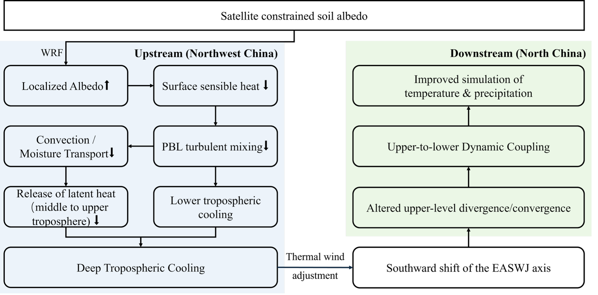

<!-- markdownlint-disable MD013 MD025 -->

# Nonlocal atmospheric response to satellite-constrained soil albedo in Northwest China improves climate simulations of North China

Jinyan Chen¹², Kai Li¹, Li Dan¹, Jiangfeng Wei³, Wei Pan¹, Fuqing Yang¹, Peng Zhou⁴, Liwen Xing¹, Long Zhao⁵, Zhen Li¹, and Hui Zheng¹

¹Institute of Atmospheric Physics, Chinese Academy of Sciences, Beijing 100029, China

²University of Chinese Academy of Sciences, Beijing 101408, China

³School of Atmospheric Sciences, Nanjing University of Information Science and Technology, Nanjing, China

⁴Institute of Disaster Risk Science, Beijing Normal University, Beijing 100875, China

⁵School of Geographical Sciences, Southwest University, Chongqing 400715, China

Corresponding author: Hui Zheng (<hzheng_iap@outlook.com>)

# Key Points {-}

- Upstream bare-soil albedo is identified as an important but overlooked source of model uncertainty for simulating downstream weather
- Correcting arid albedo bias reduces local sensible heating, triggering deep tropospheric cooling that dynamically modulates the westerly jet
- This remote atmospheric teleconnection alters vertical motion, improving simulations of downstream temperature and precipitation

# Abstract {-}

North China is vulnerable to late-spring to early-summer warm and dry conditions that affect winter wheat production, yet the contribution of upstream soil albedo errors to simulating these events remains insufficiently quantified. Here, we investigate how prescribing satellite-constrained soil albedo over Northwest China drylands affects regional climate simulations in downstream North China using high-resolution (9km) WRF model integrations across three separate dry seasons (2013, 2014, and 2020). The albedo calibration increases prescribed soil albedo over arid Northwest China, reducing net surface radiation and surface sensible heat flux. This sensible heating deficit suppresses boundary-layer turbulent mixing, creating a stable thermodynamic lid that restricts upward moisture transport. The resulting free-atmosphere moisture deficit reduces cloud condensation, inducing a deep, vertically coherent diabatic cooling column extending into the upper troposphere (200 hPa). Via thermal wind adjustments, this contracting cold air column drives a southward displacement of the East Asian Subtropical Westerly Jet (EASWJ) axis. This jet shift triggers downstream upper-level velocity potential convergence and compensatory subsidence over North China, suppressing the warm and wet biases simulated by the default configuration. Validations against station observations and GPM IMERG data reveal climate simulation improvements: the regional mean precipitation bias is reduced from 0.77 to 0.32 mm day-1, and the surface air temperature BIAS decreases from 0.63 to 0.54 K. Our findings demonstrate a physically consistent land–atmosphere–circulation teleconnection pathway, highlighting the crucial value of high-resolution satellite land constraints in mitigating systematic biases and enhancing sub-seasonal drought predictability over East Asia.

# Plain Language Summary {-}

North China is a vital agricultural region for growing winter wheat, but computer models often struggle to accurately simulate the hot and dry weather that threatens crops during late spring and early summer. In this study, we show that these simulation errors are partly caused by incorrect settings in how much sunlight the soil reflects (known as soil albedo) in the drylands of Northwest China, which lie far upstream. By using realistic satellite observations to correct these soil settings in our weather model, we made the dry desert soils more reflective. This correction reduced the heat rising from the ground, which cooled the atmosphere and shifted a major high-altitude wind current (the jet stream) slightly southward. This shift in the wind current caused air to sink over downstream North China, suppressing the model's tendency to predict too much rain and heat. By comparing our model results against actual ground measurements, we prove that correcting these upstream land settings significantly improves weather simulations downstream. Our findings highlight how satellite data can help scientists better predict severe weather and agricultural droughts across East Asia.

# Introduction

North China is a major winter wheat production region vulnerable to late-spring to early-summer drought during critical growth stages (Zeng et al., 2026). Concurrent precipitation deficits and anomalous warmth can rapidly deplete soil moisture, impair crop development, and trigger severe compound dry-hot extremes. Previous studies have attributed these droughts to large-scale drivers, including East Asian circulation variability and sea surface temperature anomalies in the Pacific and Indian Oceans (Yang et al., 2005; L. Zhang and Zhou, 2015), and have also highlighted the role of land–atmosphere interactions in shaping drought development and model representation (S. Zhang et al., 2024). In addition, upstream land-surface anomalies have been suggested to influence downstream climate over North China through atmospheric circulation adjustments (Ding et al., 2009). For example, sensitivity experiments indicate that surface albedo perturbations over the Tibetan Plateau can affect downstream climate conditions in North China (Lu et al., 2021; Smyth and Ming, 2021; Sooraj et al., 2019), while diagnostic analyses of reanalysis data suggest statistical links between spring sensible heating in Northwest China and summer drought occurrence in North China (Huang et al., 2003; Huang et al., 2013; Li et al., 2005; Zhou and Huang, 2012).

Surface albedo is a key land-surface parameter controlling the partitioning of incoming solar radiation and thereby regulating surface energy exchange processes (Dickinson, 1983; Henderson-Sellers and Wilson, 1983). Previous numerical studies have explored its climatic influence through idealized perturbations or by prescribing satellite-derived albedo fields (Lu et al., 2021; Myhre, Govaerts, et al., 2005; Smyth and Ming, 2021; Sooraj et al., 2019; Meng et al., 2018; Myhre, Kvalevåg, et al., 2005). However, these approaches often do not explicitly separate albedo contributions from different surface components (e.g., soil, vegetation, snow), which may affect the coupling between surface properties and evolving land-surface states such as soil moisture. In addition, earlier studies and statistical analyses have typically relied on coarser-resolution models or reanalysis products, which may not fully resolve vertical diabatic structures associated with boundary-layer turbulence and cloud microphysical processes that mediate the vertical coupling between the surface and the free troposphere. A process-oriented framework using high-resolution regional climate modeling is therefore useful for further examining these interactions.

Arid and sparsely vegetated regions are particularly sensitive to surface albedo variations due to their strong control on sensible heating and boundary-layer development (Albertson et al., 1995; M. Ma et al., 2011). Northwest China is representative of such environments and lies upstream of North China along the midlatitude westerly jet, where land–atmosphere coupling may influence downstream circulation. Recent studies have shown that satellite-constrained soil albedo parameterizations can affect regional climate simulations in the Tibetan Plateau region (X. Ma et al., 2025). However, it remains unclear whether similarly constrained soil albedo in Northwest China can influence simulated downstream climate anomalies in North China, and through which dynamical pathways such effects may operate.

To explore this issue, we examine the late-spring to early-summer period of 2013, 2014, and 2020 as typical case studies. These years represent distinct climatological backgrounds but share common dry and warm conditions during critical transitional phases of the East Asian Subtropical Westerly Jet (EASWJ), during which its latitudinal position shifts across the study domain, potentially modulating sensitivity to upstream forcing (Dai et al., 2021; Wang et al., 2015; Wang et al.,2026). We perform paired simulations using the Weather Research and Forecasting (WRF) model at a high-resolution grid spacing of 9 km, comparing a control configuration with default soil albedo parameters (CTL) and an experiment using MODIS-constrained soil albedo parameters (SC). The analysis focuses on how upstream soil albedo differences are associated with changes in surface energy fluxes and atmospheric circulation, and how these changes relate to simulated temperature and precipitation patterns in North China during this event.

# Data and Methods

## Regional Model and Configuration

We use the Weather Research and Forecasting (WRF) model version 4.3.2 (Skamarock et al., 2021) coupled with the Noah-MP land surface model (Niu et al., 2011). To balance physical diagnostic accuracy with the computational demands of multi-year, long-term regional climate integrations, the modeling domain covers China and adjacent regions at a 9-km horizontal grid spacing (Figure 1).

The model configuration utilizes 55 vertical levels extending to 50 hPa. At this mesoscale resolution, subgrid-scale convective processes are parameterized using the Kain–Fritsch cumulus parameterization scheme (Kain, 1993), while larger-scale organized convection is resolved explicitly by the model dynamics. The physical parameterization suite includes the Thompson microphysics scheme (Thompson et al., 2004), the Rapid Radiative Transfer Model for General Circulation Models (RRTMG) longwave and shortwave radiation schemes (Iacono et al., 2008), and the Yonsei University (YSU) planetary boundary layer scheme (Hong et al., 2006). These schemes were selected because they have been widely applied and evaluated in regional climate simulations over China and provide physically consistent representations of radiation, cloud microphysics, and boundary-layer processes relevant to land–atmosphere interactions. Similar WRF configurations have also been successfully applied in previous studies of extreme climate events and land–atmosphere interactions over China (Wang et al., 2026). Initial and 3-hourly lateral boundary conditions are derived from the European Centre for Medium-Range Weather Forecasts (ECMWF) ERA5 reanalysis at a 0.25° horizontal resolution (Hersbach et al., 2020).

## Experimental Design

In the Noah-MP land surface model, soil albedo is parameterized as a function of soil moisture and two prescribed constants, using the following equations:
$$
\alpha = min(\alpha_{sat} + 0.11 - 0.4 W_s, \alpha_{dry})
$$
where α represents the simulated soil albedo, while α_sat_ and α_dry_ denote the albedo values of saturated and dry soil, respectively. Both values are prescribed as multi-year means in the soil albedo look-up table. Ws represents the volumetric water content (m3 m-3). In the control experiment (CTL), these two parameters are set to 0.135 and 0.235, respectively, and are applied uniformly across the entire simulation domain. In the satellite-constrained sensitivity experiment (SC), these parameters vary spatially across 20 distinct soil albedo (soil color) classes, derived from the framework established for the Community Land Model (Lawrence and Chase, 2007). The soil color class assigned to each grid cell is determined by conducting offline Noah-MP simulations driven by the Global Land Data Assimilation System and selecting the specific class that minimizes the variance against the surface albedo products observed by MODIS MCD43C3 (Schaaf and Wang, 2021). The detailed method of this calibration is outlined in Chen et al. (2024); these specific constrained parameters were implemented by X. Ma et al. (2025) to assess coupled land-atmosphere simulations over the Tibetan Plateau.

To isolate regions with stronger parameter perturbations, an additional spatial mask is applied. Soil albedo modifications are retained only where the difference between SC and CTL dry- or saturated-soil albedo exceeds 0.04, a threshold chosen by considering the validation uncertainty of the MODIS albedo product. At all grid cells failing to meet this criterion, the SC experiment retains the uniform parameter values used in the CTL. This results in a spatially heterogeneous perturbation field focused on regions with larger parameter differences.

To systematically evaluate the robustness of the downstream response across different synoptic and large-scale backgrounds, paired simulations are conducted for three separate late-spring to early-summer seasons: 2013, 2014, and 2020. For each selected year, both the CTL and SC simulations are initialized on April 1. The period from April 1 to April 30 is designated as the model spin-up phase and is excluded from the analysis, leaving the evaluation period to span from May 1 to July 10, capturing the critical transitional phase when the East Asian Subtropical Westerly Jet (EASWJ) modulates the regional sensitivity to upstream thermal anomalies.

## Observations and Evaluation Metrics

Model performance is evaluated using multisource observational datasets. The 2-m surface air temperature is validated against daily observations from the China Meteorological Administration (CMA) ground station network, which underwent automated quality control and data consistency checks. Precipitation is assessed using the Global Precipitation Measurement (GPM) Integrated Multi-satellite Retrievals (IMERG) product (Huffman et al., 2023). This satellite-based high-resolution precipitation dataset provides grid-scale estimates used to evaluate the intra-seasonal variability and spatial distribution of rainfall events over East Asia.

To establish a grid-to-grid comparison for precipitation, the 9-km WRF hourly accumulation output is regridded to the 0.1° GPM IMERG grid utilizing a conservative remapping method. This conservative remapping approach preserves the area-integrated total precipitation mass across coordinate transformations, reducing interpolation-induced artificial errors during the comparison between high-resolution simulated fields and grid-scale observations. The evaluation metrics utilized include the mean bias, temporal and spatial correlation coefficients (R), and root-mean-square error (RMSE). Regional averages and statistical evaluation metrics are computed over the predefined North China target region (112°–125°E, 31°–39°N) to quantify the non-local downstream impacts of the upstream dryland albedo modifications.

# Results

## Local Surface Forcing and Energy Budget

To establish a satellite-informed land-surface forcing configuration for regional climate simulation, the satellite-derived MODIS soil albedo dataset is prescribed into the WRF modeling framework. The spatial differences between the satellite-constrained (SC) and the control parameters (CTL) show positive adjustments in both the dry-soil albedo (Δαdry, Figure 2a) and saturated-soil albedo (Δαsat, Figure 2b). These modifications are primarily located over the arid region of Northwest China and the northwestern Tibetan Plateau. The corresponding three-season mean soil moisture field from the CTL simulations indicates predominantly dry conditions in the modified upstream region, with top-layer volumetric soil water content generally below 0.10 m3 m-3 (Figure 2c). The soil moisture response induced by the albedo perturbation remains relatively weak, with differences between the SC and CTL experiments generally around −0.01 m³ m⁻³ in the modified region (Figure 2d), suggesting that the soil moisture response is relatively weak compared with the imposed soil albedo parameter perturbations.

![**Figure 2.** Spatial distributions of prescribed soil albedo parameter modifications, background soil moisture state, and soil moisture differences (SC–CTL). Prescriptive spatial differences in (a) dry-soil albedo (Δαdry) and (b) saturated-soil albedo (Δαsat) between the SC and CTL experiments (SC minus CTL). (c) Simulated mean volumetric soil moisture (m3 m-3) of the top soil layer in the CTL experiment averaged from May 1 to July 10 averaged across the three selected seasons (2013, 2014, and 2020). Spatial differences in (d) soil moisture between the SC and CTL experiments (SC minus CTL). The black polygons delineate the upstream forcing regions (primarily Northwest China and the Tibetan Plateau). The green box highlights the downstream North China region analyzed for nonlocal atmospheric responses.](fig/Figure01.png)

The prescribed albedo changes lead to an increase in simulated surface albedo over the perturbed regions, with differences ranging from approximately +0.02 to +0.06 (Figure 3a). This increase is associated with a reduction in net shortwave radiation, with local anomalies exceeding −15 W m⁻² (Figure 3b). The reduced shortwave absorption cools the land surface, lowering the surface skin temperature. This localized cooling subsequently reduces the upward longwave radiation emitted by the surface, which manifests as a positive anomaly in net longwave radiation of up to +5 W m⁻² over the forcing domain (Figure 3c). Despite this partial compensatory thermal response, the reduction in shortwave absorption dominates the surface radiative budget, resulting in a net surface radiation deficit ranging from -10 to -15 W m⁻² across the perturbed upstream domain (Figure 3d).

The surface energy budget response is further examined through turbulent heat fluxes. Under dry and sparsely vegetated conditions, the surface energy balance in upstream region is primarily governed by sensible heating. The reduction in net radiation is therefore mainly balanced by a decrease in surface sensible heat flux (HFX), with spatial patterns closely matching those of net radiation anomalies. Reductions in sensible heat flux reach approximately −10 to −15 W m⁻² over the core forcing region (Figure 3e). In contrast, the surface latent heat flux (LH) shows comparatively weak responses within the upstream domain (Figure 3f), consistent with moisture-limited surface conditions.

Although the albedo modifications are confined to the upstream domain (black polygons in Figure 2a, b), differences in surface energy fluxes are also evident over downstream North China (green box in Figure 3). Since no land-surface parameters are modified in the downstream region, these flux differences represent an atmospheric-mediated response within the coupled land-atmosphere system rather than a direct surface forced response. The spatial structure of these downstream anomalies, along with the underlying vertical diabatic structures and atmospheric circulation adjustments, is systematically examined in the subsequent sections.

## The Vertical Profile

To examine the vertical structure of atmospheric responses associated with the upstream surface perturbations, we analyze the longitude–altitude cross-sections averaged over 30°–50°N. The results show a negative temperature anomaly extending from the surface to the upper troposphere (~200 hPa) over the forcing region (Figure 4a). This is accompanied by a negative geopotential height anomaly throughout the tropospheric column, with the strongest signal in the upper troposphere (~300–200 hPa). Crucially, regional heat budget analysis indicates that this deep column cooling is primarily driven by local diabatic cooling anomalies, whereas horizontal temperature advection acts as a major compensating warming term rather than the primary driver (Figure 4b).

The total diabatic heating rate is partitioned into individual physical processes in WRF to examine the heat budget at different altitudes. In the lower troposphere (below 600 hPa), cooling tendencies are mainly associated with planetary boundary layer (PBL) mixing processes (Figure 5a), which control the vertical turbulent transport of heat. Consistent with the reduced surface sensible heat flux under increased albedo conditions (Figure 3e), the turbulent energy transport from the surface is suppressed. Crucially, this weakened turbulent mixing leads to a stabilization of the lower atmosphere, causing a pronounced reduction in boundary-layer height. The simulated mean planetary boundary layer height (PBLH) shows a decrease of more than 50m over the upstream region in the SC experiment relative to CTL (Figure 5b). This shallow, highly stable boundary layer acts as a thermodynamic lid, trapping the land-forced cold anomalies within the lower layers and suppressing the upward transport of both heat and moisture.

This lower-tropospheric cooling, confined beneath the stable boundary layer, restricts the vertical transport of moisture into the free troposphere. As shown in Figure 6b, the water vapor mixing ratio (ΔQvapor) exhibits vertically coherent negative anomalies throughout the lower and middle troposphere, which suppresses cloud condensation processes. Because condensational latent heat release serves as the primary diabatic heat source for the free atmosphere in this region, its reduction is associated with the dominant diabatic cooling tendency above 500 hPa. This co-reduction of water vapor and cloud water explains why the diabatic cooling in the middle and upper troposphere is dominated by cloud microphysical processes (Figure 6a).

Finally, the associated column-integrated cooling is consistent with a reduction in geopotential height, with the strongest anomalies near 300-200 hPa (Figure 4a). Correspondingly, this upper-tropospheric geopotential height reduction is accompanied by easterly wind anomalies near the model top, indicating a deceleration of the midlatitude westerly jet stream in response to the contracting cold air column. This contrasts with findings over the Southern Great Plains, where higher albedo induced lower-tropospheric warming via atmospheric radiative heating (Park and Wu, 2010); in the arid Northwest China, such radiative heating is weak (Figure 6a), allowing turbulent and microphysical condensational cooling to dominate.

## Upper-level Circulation Adjustment

The deep tropospheric cooling is associated with a negative geopotential height anomaly in the upper troposphere over the forcing region, with a maximum reduction of approximately 60 gpm at 200 hPa (Figure 7a). This cold-core anomaly is dynamically consistent with a localized cyclonic circulation adjustment around the cooling center. According to the thermal wind relationship, this localized cooling modifies the meridional temperature gradient across the forcing region, which modulates the East Asian Subtropical Westerly Jet (EASWJ). On the northern flank, the reduced temperature gradient weakens the upper-level westerlies, whereas on the southern flank the enhanced gradient strengthens them. This asymmetric response shifts the jet axis southward over the forcing region (Figure 7a).

North China lies downstream and near the southern edge of the EASWJ, where this jet displacement is dynamically linked to downstream circulation adjustments. The anomalies in 200 hPa velocity potential and wind speed exhibit a clear north–south dipole structure over the North China target region (Figure 7b). Positive velocity potential anomalies (associated with convergent wind vectors) dominate the northern sector of the target domain, whereas negative anomalies (associated with divergent wind vectors and enhanced wind speed) are confined to the southern sector. This dipole pattern modulates vertical motion in the lower and middle troposphere (Figure 7c, d). In the northern sector of North China, upper-level convergence is consistent with dynamically induced subsidence in the mid- and lower troposphere (500 and 850 hPa), whereas in the southern sector, upper-level divergence is associated with upward motion extending through the tropospheric column.

Furthermore, although the lower-tropospheric wind anomalies at 850 hPa exhibit clear regional circulation adjustments over North China, these responses remain spatially confined to the downstream region rather than indicating a fundamental reorganization of the broader East Asian Summer Monsoon (EASM) circulation (Figure 7d). The background monsoon inflow pathways remain structurally intact over the broader East Asian domain.

![**Figure 7** Large-scale circulation adjustment and modulation of the EASWJ. All panels show the mean differences between the satellite-constrained (SC) and control (CTL) simulations (SC minus CTL) for the period from May 1 to July 10 across the three selected seasons (2013, 2014, and 2020). (a) Anomalies in 200 hPa geopotential height (shading; gpm) and wind vectors (m s⁻¹). The solid and dashed blue lines represent the EASWJ axis (axis: 30 m s⁻¹ isotach; edge: 25 m s⁻¹ isotach) for the CTL and SC experiments, respectively. (b) Anomalies in 200 hPa divergence and wind speed. (c), (d) Multi-level responses in the (c) middle (500 hPa) and (d) lower (850 hPa) troposphere, showing wind vector differences (arrows; m s⁻¹) and vertical velocity anomalies (Δw; cm s⁻¹).](fig/Figure07.png)

## Impacts on Downstream Climate

The upstream soil albedo perturbation induces downstream climate responses over North China through the identified non-local circulation pathway, resulting in improved simulation performance. The southward adjustment of the EASWJ modifies the downstream dynamical environment by inducing changes in upper-level circulation, convergence/divergence patterns, and associated vertical motion. These circulation adjustments further regulate regional moisture convergence, cloud formation, and surface energy partitioning, providing a physical pathway through which the upstream perturbation influences downstream precipitation and surface temperature responses.

For precipitation, the satellite-constrained (SC) simulation exhibits a spatially heterogeneous response over North China (Figure 8). The precipitation anomalies are broadly consistent with the altered dynamical conditions, particularly the changes in vertical motion (Figure 7c, d) and moisture transport (Figure 10a), while the spatial heterogeneity reflects the combined effects of large-scale circulation adjustment and local convective processes. The 850 hPa moisture flux convergence anomaly exhibits a spatially heterogeneous pattern that reflects the redistribution of low-level moisture transport associated with the circulation adjustment (Figure 10a). Regions with reduced moisture convergence indicate weakened low-level moisture accumulation, which may limit the availability of atmospheric moisture for precipitation development. The spatially heterogeneous reduction in total cloud water path (Figure 10b) is broadly consistent with the circulation-induced changes in moisture transport and vertical motion, suggesting a suppression of cloud development under less favorable dynamical conditions. Compared with the control (CTL) simulation, the SC experiment reduces the precipitation wet bias and improves the spatial representation of rainfall variability. The domain-averaged precipitation bias decreases from 0.77 mm day⁻¹ in CTL to 0.32 mm day⁻¹ in SC, accompanied by a reduction in RMSE from 15.71 to 15.10 mm day⁻¹ and an increase in the temporal correlation coefficient (Figure 9).

![**Figure 10** Dynamical, moisture, cloud-radiative, and surface energy responses associated with upper-level circulation adjustment. All panels show the mean differences between the satellite-constrained (SC) and control (CTL) simulations (SC minus CTL) for the period from May 1 to July 10 across the three selected seasons (2013, 2014, and 2020). (a) 850 hPa moisture flux convergence anomalies. (b) Total cloud water path anomalies (kg m⁻²). (c) Surface downward shortwave radiation anomalies (W m⁻²). (d) Surface sensible heat flux anomalies (W m⁻²).](fig/Figure10.png)

These coupled moisture and cloud-radiative responses indicate that the circulation adjustment influences not only precipitation processes but also surface energy conditions relevant to temperature changes. The reduction in total cloud water path is accompanied by enhanced downward shortwave radiation in corresponding regions (Figure 10c), indicating a cloud-radiative contribution to the surface energy adjustment. The enhanced surface radiative input is accompanied by changes in surface energy partitioning, including increased sensible heat flux, suggesting a thermodynamic pathway linking circulation adjustment to surface air temperature responses. According to the evaluation results, the SC simulation shows better agreement with station observations than the CTL simulation, indicating that the SC simulation better reproduces the observed temporal evolution and reduces the temperature bias relative to CTL. Domain-wide boxplot evaluations confirm that the regional mean BIAS for temperature decreases from 0.63 K in the CTL to 0.54 K in the SC (Figure 11a), and the mean temporal correlation increases from 0.63 to 0.65 (Figure 11c), with these improvements being statistically significant at the 95% confidence level (p < 0.05).

The magnitude of this simulation improvement varies between the two sub-periods of the seasonal cycle, exhibiting a stronger signal during the later sub-period (June 15–July 10) (Figure 13). This temporal variation is tied to the natural seasonal evolution of the EASWJ. During the earlier sub-period (May 1–June 15), before the jet completes its seasonal transition, the simulated improvement is relatively smaller but remains present in the time series. During the later sub-period, the EASWJ approaches its climatological summer position, when the downstream region becomes more sensitive to upstream circulation anomalies. As a result, the SC simulation captures the peak precipitation events and modifies the simulated warm anomalies observed in the CTL during late June (Figure 13). These results demonstrate that incorporating satellite-constrained soil albedo over Northwest China alters the simulation of downstream temperature and precipitation through a non-local circulation pathway identified in this case study.

# Discussion

A scientific challenge in diagnosing nonlocal land-atmosphere teleconnections is distinguishing the land-surface-forced response from internal atmospheric variability inherent to numerical modeling. In regional climate simulations of midlatitude transition zones, minor differences in initial atmospheric states can grow non-linearly over monthly timescales, potentially generating spurious downstream anomalies that obscure the forced land-surface signal. To evaluate the robustness of the simulated teleconnection and examine whether the downstream climate improvements persist under perturbed atmospheric initial conditions, we performed an initial-condition perturbation experiment. Specifically, we executed a paired set of sensitivity simulations for the 2014 season with identical MODIS-constrained soil albedo modifications (SC versus CTL) but initialized on May 1 using the restart atmospheric state outputted from May 2. This 24-hour time-shift in the initial conditions introduces a minor, high-frequency perturbation to the initial atmospheric states while maintaining identical lateral boundary conditions and land-surface configurations. By integrating both the unperturbed and perturbed simulations from May 1 to July 10, 2014, we can evaluate the reproducibility of downstream meteorological metrics under perturbed atmospheric initial conditions.

The evaluation of precipitation simulation indicates that the impact of the satellite-constrained soil albedo perturbation is partially preserved under perturbed atmospheric initial conditions, although the magnitude of improvement differs among metrics (Figure 14). In the unperturbed simulation, the SC experiment improves precipitation representation by reducing the mean bias from −1.37 to −1.20 mm day⁻¹ and increasing the temporal correlation coefficient from 0.38 to 0.46. Under perturbed initial conditions (RST), the SC experiment continues to reduce precipitation-related errors, with RMSE decreasing from 9.14 to 7.72 mm day⁻¹ and absolute bias decreasing from 1.71 to 1.23 mm day⁻¹. Although the temporal correlation response is less consistent, the persistence of error reduction suggests that the downstream precipitation adjustment associated with the upstream soil albedo perturbation is not solely dependent on a specific atmospheric initial state.

![**Figure 14** Boxplot evaluations of daily precipitation simulation performance over the downstream North China target region. Panels (a–c) show the metrics for the unperturbed 2014 simulation, while panels (d–f) show the metrics under perturbed atmospheric initial conditions (RST, restarting from 20140502 instead of 20140501). Metrics evaluated against GPM IMERG data include: (a, d) root-mean-square error (RMSE; mm day-1), (b, e) mean bias (BIAS; mm day-1), and (c, f) temporal correlation coefficient (R). The solid black lines represent the medians, and the dashed yellow lines denote the mean values for the CTL (blue boxes) and SC (red boxes) experiments.](fig/Figure14.png)

A similar response is found for surface air temperature simulation (Figure 15). In the unperturbed experiment, prescribing satellite-constrained soil albedo reduces temperature RMSE from 3.02°C to 2.89°C and increases the temporal correlation coefficient from 0.76 to 0.800. Under perturbed atmospheric initial conditions, the systematic temperature bias remains reduced, with the mean bias decreasing from 1.24°C to 1.03°C and the absolute bias decreasing from 1.93°C to 1.82°C. However, changes in RMSE and temporal correlation are weaker under RST conditions, indicating that the magnitude of temperature response is more sensitive to atmospheric internal variability. Overall, these results demonstrate that the satellite-constrained soil albedo perturbation produces a reproducible downstream influence on regional climate simulations, while the detailed magnitude of the response depends on the atmospheric state.

![**Figure 15** Boxplot evaluations of daily mean surface air temperature simulation performance over the downstream North China target region. Panels (a–c) show the metrics for the unperturbed 2014 simulation, while panels (d–f) show the metrics under perturbed atmospheric initial conditions (RST, restarting from 20140502 instead of 20140501). Metrics evaluated against CMA ground station data include: (a, d) root-mean-square error (RMSE; K), (b, e) mean bias (BIAS; K), and (c, f) temporal correlation coefficient (R). The solid black lines represent the medians, and the dashed yellow lines denote the mean values for the CTL (blue boxes) and SC (red boxes) experiments.](fig/Figure15.png)

Several limitations of this study should be acknowledged. While the nonlocal response is reproduced across three separate dry cases and remains detectable under initial-condition perturbations, the magnitude and fine-scale features of the atmospheric response may be sensitive to the selection of physical parameterization schemes within the WRF model. In particular, the vertical diabatic structures of the PBL and cloud microphysics—which we identified as critical mediators of the column cooling—are subject to parameterization uncertainties. Future studies employing multi-scheme ensemble designs are warranted to quantify these physical sensitivities.

# Conclusions

The results presented in this study demonstrate that prescribing satellite-constrained soil albedo over the arid drylands of Northwest China improves regional climate simulations of temperature and precipitation in downstream North China. By conducting high-resolution (9 km) WRF simulations across three separate late-spring to early-summer dry seasons (2013, 2014, and 2020), this study provides evidence for a physically consistent and dynamically robust teleconnection pathway. This land-forced downstream modification exhibits a strong state-dependency tied to the seasonal transition of the background atmospheric circulation. The teleconnection pathway becomes fully engaged after mid-June as the East Asian Subtropical Westerly Jet (EASWJ) axis shifts northward directly over the latitude of North China, acting as an efficient dynamic wave-guide that facilitates the non-local propagation of upstream thermal anomalies.

The diagnostic analysis reveals a coupled land–atmosphere–circulation adjustment pathway mediating this teleconnection. The higher satellite-constrained soil albedo reduces net shortwave radiation and surface net radiation, which is balanced almost entirely by a reduction in surface sensible heat flux over the moisture-limited upstream forcing region. This sensible heating deficit suppresses boundary-layer turbulent mixing, causing a widespread boundary layer collapse. This shallow, highly stable boundary layer acts as a thermodynamic lid that restricts upward moisture transport. The resulting free-atmosphere moisture deficit suppresses cloud condensation and condensational latent heat release in the middle and upper troposphere, forming a deep, vertically coherent diabatic cooling column extending to 200 hPa. Via thermal wind adjustments, this contracting cold air column drives a southward displacement of the EASWJ axis. Consequently, this jet shift triggers upper-level velocity potential convergence and compensatory subsidence in the lower and middle troposphere over North China, suppressing the systematic warm and wet biases. Validation against daily station observations and GPM IMERG data indicates improved regional simulation performance: the regional mean precipitation wet bias is reduced from 0.77 to 0.32 mm day-1, and the surface air temperature BIAS decreases from 0.63K to 0.54K (p < 0.05).

The robustness of this nonlocal land-forced response is further evaluated across different dimensions of atmospheric variability. By evaluating three separate drought years (2013, 2014, and 2020) characterized by distinct large-scale background climes, we find that the southward shift of the jet and downstream subsidence is consistent, recurring dynamic responses rather than case-specific anomalies. Furthermore, an initial-condition perturbation experiment executed via time-shifted restart runs demonstrates that while downstream fluxes show natural synoptic variability, the core features of the local upstream forcing and nonlocal downstream feedback patterns are highly reproducible and consistent. The simulated land-forced response remains detectable despite internal atmospheric variability over the monthly integration. This supports the physical credibility of the simulated teleconnection, suggesting potential value for improving subseasonal climate simulation and understanding compound hot-dry hazards.

In conclusion, these findings underscore the scientific importance of reducing systematic uncertainties in upstream land-surface parameters, particularly soil albedo over arid drylands, to improve downstream regional climate simulations. Implementing high-resolution, satellite-derived constraints in coupled land–atmosphere modeling frameworks offers a powerful avenue to mitigate systematic model biases and enhance the representation and simulation of compound agricultural hazards at subseasonal timescales.

# Acknowledgements {-}

This study was jointly supported by the National Key Research and Development Program of China (Grant No. 2023YFF0805501), the National Natural Science Foundation of China (grant 42275178), Strategic Priority Research Program of the Chinese Academy of Sciences (XDB1660103) and the National Key Scientific and Technological Infrastructure project "Earth System Numerical Simulation Facility" (EarthLab) (2025-EL-PT-001061).

# Open Research {-}

The ERA5 reanalysis data used in this study were obtained from the Copernicus Climate Change Service (C3S) Climate Data Store (<https://doi.org/10.24381/cds.adbb2d47> and <https://doi.org/10.24381/cds.bd0915c6>). MODIS albedo products (MCD43C3) were retrieved from the NASA Land Processes Distributed Active Archive Center (LP DAAC) (<https://doi.org/10.5067/MODIS/MCD43C3.061>). Surface air temperature observations are provided by the China Meteorological Data Service Centre (<http://data.cma.cn/en>) and are available upon registration. GPM IMERG precipitation data (V07) were accessed via the NASA Precipitation Processing System (<https://doi.org/10.5067/GPM/IMERG/3B-HH/07>). The WRF model (version 4.3.2) is an open-source community model available at <https://github.com/wrf-model/WRF>. The processed data and diagnostic scripts used for plotting Figures are archived and available at <https://doi.org/10.5281/zenodo.20290218>.

# References {-}

Albertson, J. D., Parlange, M. B., Katul, G. G., Chu, C.-R., Stricker, H., & Tyler, S. (1995). Sensible heat flux from arid regions: A simple flux-variance method. Water Resources Research, 31(4), 969–973. <https://doi.org/10.1029/94WR02978>

Chen, J., Zhao, L., Yang, K., Tian, J., Pan, J., & Zhang, K. (2024). Toward Optimization of Key Parameters in Noah-MP Surface Albedo Using Satellite Remote Sensing Products. Chinese Journal of Space Science (in Chinese), 43(6), 1135–1149. <https://doi.org/10.11728/cjss2023.06.2023-0086>

Chen, J., Zheng, H., Li, K., Dan, L., Wei, J., Pan, W., Yang, F., Zhou, P., Xing, L., & Zhao, L. (2026). Nonlocal atmospheric response to satellite-constrained soil albedo in Northwest China improves climate simulations of North China. Zenodo. <https://doi.org/10.5281/zenodo.20290218>

Dai, T. L., Wang, Q. L., Wang, G. F., Chen, Y., Zhao, S. S., Zhai, J. Q., et al. (2021). Major characteristics of china’s climate and main meteorological events in 2020. Meteorological Monthly, 47(04), 478–487. <https://doi.org/10.7519/j.issn.1000-0526.2021.04.009>

Dickinson, R. E. (1983). Land surface processes and climate—surface albedos and energy balance. In B. Saltzman (Ed.), Advances in Geophysics (Vol. 25, pp. 305–353). Elsevier. <https://doi.org/10.1016/S0065-2687(08)60176-4>

Ding, Y., Sun, Y., Wang, Z., Zhu, Y., & Song, Y. (2009). Inter-decadal variation of the summer precipitation in China and its association with decreasing Asian summer monsoon Part II: Possible causes. International Journal of Climatology, 29(13), 1926–1944. <https://doi.org/10.1002/joc.1759>

Henderson-Sellers, A., & Wilson, M. F. (1983). Surface albedo data for climatic modeling. Reviews of Geophysics, 21(8), 1743–1778. <https://doi.org/10.1029/rg021i008p01743>

Hersbach, H., Bell, B., Berrisford, P., Hirahara, S., Horányi, A., Muñoz-Sabater, J., et al. (2020). The ERA5 global reanalysis. Quarterly Journal of the Royal Meteorological Society, 146(730), 1999–2049. <https://doi.org/10.1002/qj.3803>

Hersbach, H., Bell, B., Berrisford, P., Biavati, G., Horányi, A., Muñoz Sabater, J., Nicolas, J., Peubey, C., Radu, R., Rozum, I., Schepers, D., Simmons, A., Soci, C., Dee, D., Thépaut, J-N. (2023a). ERA5 hourly data on pressure levels from 1940 to present [Dataset]. Copernicus Climate Change Service (C3S) Climate Data Store (CDS). <https://doi.org/10.24381/cds.bd0915c6>

Hersbach, H., Bell, B., Berrisford, P., Biavati, G., Horányi, A., Muñoz Sabater, J., Nicolas, J., Peubey, C., Radu, R., Rozum, I., Schepers, D., Simmons, A., Soci, C., Dee, D., Thépaut, J-N. (2023b). ERA5 hourly data on single levels from 1940 to present [Dataset]. Copernicus Climate Change Service (C3S) Climate Data Store (CDS). <https://doi.org/10.24381/cds.adbb2d47>

Hong, S., Noh, Y., & Dudhia, J. (2006). A New Vertical Diffusion Package with an Explicit Treatment of Entrainment Processes. Monthly Weather Review, 134(9), 2318-2341. <https://doi.org/10.1175/MWR3199.1>

Huang, R., Chen, J., Zhou, L., & Zhang, Q. (2003). Studies on the Relationship between the Severe Climatic Disasters in China and the East Asia Climate System. Chinese Journal of Atmospheric Science (in Chinese), 27(4), 770–788. <https://doi.org/10.3878/j.issn.1006-9895.2003.04.22>

Huang, R., Zhou, D., Chen, W., Zhou, L., Wei, Z., Zhang, Q., et al. (2013). Recent progress in studies of air-land interaction over the arid area of Northwest China and its impact on climate. Chinese Journal of Atmospheric Science (in Chinese), 37(2), 189–210. <https://doi.org/10.3878/j.issn.1006-9895.2012.12303>

Huffman, G. J.; Stocker, E. F.; Bolvin, D. T.; Nelkin, E. J.; Tan, J. (2023). GPM IMERG Final Precipitation L3 Half Hourly 0.1 degree x 0.1 degree V07 [Dataset]. Greenbelt, MD, Goddard Earth Sciences Data and Information Services Center (GES DISC). <https://doi.org/10.5067/GPM/IMERG/3B-HH/07>

Iacono, M. J., Delamere, J. S., Mlawer, E. J., Shephard, M. W., Clough, S. A., & Collins, W. D. (2008). Radiative forcing by long-lived greenhouse gases: Calculations with the AER radiative transfer models. Journal of Geophysical Research: Atmospheres, 113(D13), D13103. <https://doi.org/10.1029/2008JD009944>

Kain, J.S., Fritsch, J.M. (1993). Convective Parameterization for Mesoscale Models: The Kain-Fritsch Scheme. In: Emanuel, K.A., Raymond, D.J. (eds) The Representation of Cumulus Convection in Numerical Models. Meteorological Monographs. American Meteorological Society, Boston, MA. <https://doi.org/10.1007/978-1-935704-13-3_16>

Lawrence, P. J., & Chase, T. N. (2007). Representing a new MODIS consistent land surface in the Community Land Model (CLM 3.0). Journal of Geophysical Research: Biogeosciences, 112(G1), 2006JG000168. <https://doi.org/10.1029/2006JG000168>

Li, D., Jinjun, J., & Peiqun, Z. (2005). The soil moisture of china in a high resolution climate-vegetation model. Advances in Atmospheric Sciences, 22(5), 720–729. Journal Article. <https://doi.org/10.1007/BF02918715>

Lu, M., Yang, S., Wang, J., Wu, Y., & Jia, X. (2021). Response of regional Asian summer monsoons to the effect of reduced surface albedo in different Tibetan Plateau domains in idealized model experiments. Journal of Climate, 34(17), 7023–7036. <https://doi.org/10.1175/JCLI-D-20-0500.1>

Ma, M., Pu, Z., Wang, S., & Zhang, Q. (2011). Characteristics and numerical simulations of extremely large atmospheric boundary-layer heights over an arid region in North-West China. Boundary-Layer Meteorology, 140(1), 163–176. <https://doi.org/10.1007/s10546-011-9608-2>

Ma, X., Zhao, L., Sun, J., Chen, J., Wang, Y., Zhou, J., et al. (2025). Optimization of key land surface albedo parameter reduces wet bias of climate modeling for the Tibetan Plateau. Science China Earth Sciences, 68(8), 2653–2662. <https://doi.org/10.1007/s11430-025-1635-0>

Meng, X., Lyu, S., Zhang, T., Zhao, L., Li, Z., Han, B., et al. (2018). Simulated cold bias being improved by using MODIS time-varying albedo in the Tibetan Plateau in WRF model. Environmental Research Letters, 13(4), 044028. <https://doi.org/10.1088/1748-9326/aab44a>

Myhre, G., Govaerts, Y., Haywood, J. M., Berntsen, T. K., & Lattanzio, A. (2005). Radiative effect of surface albedo change from biomass burning. Geophysical Research Letters, 32(20). <https://doi.org/10.1029/2005GL022897>

Myhre, G., Kvalevåg, M. M., & Schaaf, C. B. (2005). Radiative forcing due to anthropogenic vegetation change based on MODIS surface albedo data. Geophysical Research Letters, 32(21). <https://doi.org/10.1029/2005GL024004>

Niu, G.-Y., Yang, Z.-L., Mitchell, K. E., Chen, F., Ek, M. B., Barlage, M., et al. (2011). The community Noah land surface model with multiparameterization options (Noah-MP): 1. Model description and evaluation with local-scale measurements. Journal of Geophysical Research: Atmospheres, 116(D12), D12109. <https://doi.org/10.1029/2010JD015139>

Park, S., & Wu, X. (2010). Effects of surface albedo on cloud and radiation processes in cloud-resolving model simulations. Journal of the Atmospheric Sciences, 67(5), 1474–1491. <https://doi.org/10.1175/2009JAS3291.1>

Schaaf, C., & Wang, Z. (2021). MODIS/Terra+Aqua BRDF/Albedo Albedo Daily L3 Global 0.05Deg CMG V061 [Dataset]. NASA Land Processes Distributed Active Archive Center. <https://doi.org/10.5067/MODIS/MCD43C3.061>

Skamarock, W. C., Klemp, J. B., Dudhia, J., Gill, D. O., Liu, Z., Berner, J., et al. (2021). A description of the advanced research WRF model version 4.3 ({{NCAR Technical Note}} No. NCAR/TN–556+STR). UCAR/NCAR. <https://doi.org/10.5065/1DFH-6P97>

Smyth, J. E., & Ming, Y. (2021). Investigating the impact of land surface characteristics on monsoon dynamics with idealized model simulations and theories. Journal of Climate, 34(19), 7943–7958. <https://doi.org/10.1175/JCLI-D-20-0954.1>

Sooraj, K. P., Terray, P., Masson, S., & Crétat, J. (2019). Modulations of the Indian summer monsoon by the hot subtropical deserts: Insights from coupled sensitivity experiments. Climate Dynamics, 52(7), 4527–4555. <https://doi.org/10.1007/s00382-018-4396-8>

Thompson, G., Rasmussen, R. M., & Manning, K. (2004). Explicit forecasts of winter precipitation using an improved bulk microphysics scheme. Part I: Description and sensitivity analysis. Monthly Weather Review, 132(2), 519–542. <https://doi.org/10.1175/1520-0493(2004)132><0519:EFOWPU>2.0.CO;2

Wang, H., & He, S. (2015). The North China/Northeastern Asia Severe Summer Drought in 2014. Journal of Climate, 28(17), 6667-6681. <https://doi.org/10.1175/JCLI-D-15-0202.1>

Wang, S., Wang, S., Zhang, M., Tang, J., Yan, X., & Fu, C. (2026). Dynamic downscaling resolution affects hot extreme processes: A case study of 2013 summer extreme hot event over central and eastern China. Geophysical Research Letters, 53, e2025GL119257. <https://doi.org/10.1029/2025GL119257>

Yang, X.-Q., Xie, Q., Zhu, Y.-M., Sun, X.-G., & Guo, Y.-J. (2005). Decadal-to-interdecadal variability of precipitation in North China and associated atmospheric and oceanic anomaly patterns. Chinese Journal of Geophysics (in Chinese), 48(4), 789–797.

Zeng, R., Lin, X., Sassenrath, G. F., Welch, S. M., & Yao, F. (2026). Current and projected impacts of extreme climate events on winter wheat yield in Northern China. Communications Earth & Environment, 7(1), 100. <https://doi.org/10.1038/s43247-025-02954-2>

Zhang, L., & Zhou, T. (2015). Drought over East Asia: A review. Journal of Climate, 28(8), 3375–3399. <https://doi.org/10.1175/JCLI-D-14-00259.1>

Zhang, S., Wang, L., & He, C. (2024). Dry coupling aggravates soil drought and atmospheric aridity over North China. Journal of Geophysical Research: Atmospheres, 129(24), e2024JD041566. <https://doi.org/10.1029/2024JD041566>

Zhou, L., & Huang, R. (2012). Interdecadal Variability of Sensible Heat in Arid and Semi-Arid Regions of Northwest China and Its Relation to Summer Precipitation in China. Chinese Journal of Atmospheric Science (in Chinese), 32(6), 1276–1288. <https://doi.org/10.3878/j.issn.1006-9895.2008.06.04>
