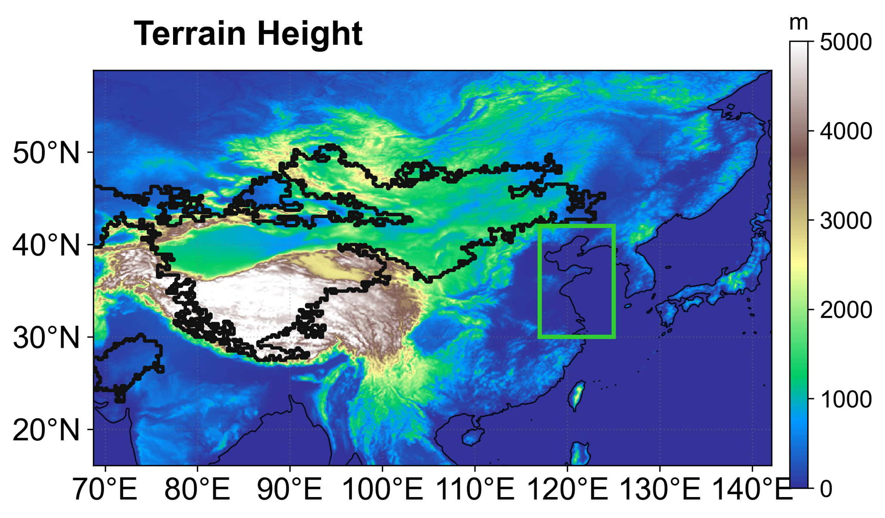
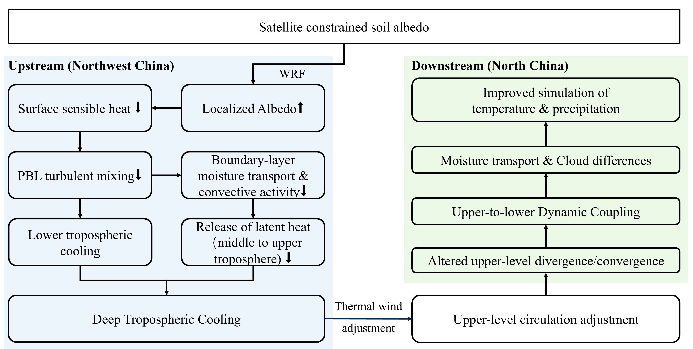

<!-- markdownlint-disable MD013 MD025 -->

# Satellite-constrained soil albedo parameters in Northwest China nonlocally improve surface climate simulations of North China {-}

Jinyan Chen¹², Kai Li¹, Li Dan¹, Jiangfeng Wei³, Wei Pan¹, Fuqiang Yang¹, Peng Zhou⁴, Liwen Xing¹, Long Zhao⁵, Zhen Li¹, and Hui Zheng¹

¹Institute of Atmospheric Physics, Chinese Academy of Sciences, Beijing 100029, China

²University of Chinese Academy of Sciences, Beijing 101408, China

³School of Atmospheric Sciences, Nanjing University of Information Science and Technology, Nanjing, China

⁴Institute of Disaster Risk Science, Beijing Normal University, Beijing 100875, China

⁵School of Geographical Sciences, Southwest University, Chongqing 400715, China

Corresponding author: Hui Zheng (<hzheng_iap@outlook.com>)

# Key Points {-}

- Bare-soil albedo in Northwest China is an overlooked source of model uncertainty for simulating downstream climate over North China
- Correcting arid soil albedo triggers deep tropospheric cooling through suppressed boundary-layer mixing and reduced cloud condensation
- Jet-advected upper-tropospheric cooling alters circulation, bringing drier air into North China and improving temperature and precipitation

# Abstract {-}

Northwest China contains extensive bare-soil regions, yet whether and how bare-soil albedo parameterization influences downstream climate over eastern China remains unclear. Here, we investigate this nonlocal impact on North China during late spring to early summer, a period when the East Asian Summer Monsoon has not fully established and dry conditions frequently threaten winter wheat production. We perform paired WRF–Noah-MP simulations at 9-km resolution across three dry seasons (2013, 2014, and 2020), comparing default soil albedo parameters against satellite-constrained parameters. The satellite-constrained calibration increases soil albedo over arid Northwest China, reducing net surface radiation and sensible heat flux. This heating deficit suppresses boundary-layer mixing, creating a thermodynamic lid that restricts upward moisture transport and induces a deep diabatic cooling column extending to the upper troposphere. The East Asian Subtropical Westerly Jet advects this cooling eastward, weakening the meridional temperature gradient and inducing a cyclonic circulation anomaly over Northeast China. Northerly winds on the western flank of this cyclone drive drier air into North China, reducing cloud cover and enhancing surface downwelling shortwave radiation, which together reduce the systematic cold and wet biases in the default simulation. Validation against station observations and GPM IMERG data shows a reduction in regional mean precipitation bias reduced from 0.46 to 0.15 mm day⁻¹ and in surface air temperature bias from −0.83 to −0.67 K. These findings reveal a physically consistent nonlocal teleconnection pathway, highlighting the value of satellite-constrained land-surface parameters for improving regional climate simulations over East Asia.

# Plain Language Summary {-}

North China is a vital agricultural region for growing winter wheat, but computer models often struggle to accurately simulate the hot and dry weather that threatens crops during late spring and early summer. In this study, we show that these simulation errors are partly caused by incorrect settings in how much sunlight the soil reflects (known as soil albedo) in the drylands of Northwest China, which lie far upstream. By using realistic satellite observations to correct these soil settings in our weather model, we made the dry desert soils more reflective. This correction reduced the heat rising from the ground, which cooled the atmosphere. A major high-altitude wind current (the jet stream) carried this cooling downstream, weakening the north–south temperature contrast and shifting regional wind patterns. These wind changes brought drier air into North China, reducing cloud cover and allowing more sunlight to reach the surface. As a result, the corrected simulation produced more realistic temperatures and rainfall, reducing errors compared with ground measurements. Our findings highlight how satellite data can help scientists better predict severe weather and agricultural droughts across East Asia.

# Introduction

Northwest China contains extensive bare-soil regions whose surface albedo is poorly constrained in land-surface models, yet the influence of these upstream drylands on downstream climate remains unclear. North China, situated downstream of these drylands, is a major winter wheat production region vulnerable to late-spring to early-summer drought during critical growth stages [@zeng2026CEE]. Concurrent precipitation deficits and anomalous warmth can rapidly deplete soil moisture, impair crop development, and trigger severe compound dry-hot conditions. Previous studies have attributed these droughts to large-scale drivers, including East Asian circulation variability and sea surface temperature anomalies in the Pacific and Indian Oceans [@yang2005CJG; @zhang2015JC], and have also highlighted the role of land–atmosphere interactions in shaping drought development and model representation [@zhang2024JGRAb]. In addition, upstream land-surface anomalies have been suggested to influence downstream climate over North China through atmospheric circulation adjustments [@ding2009IJC]. For example, sensitivity experiments indicate that surface albedo perturbations over the Tibetan Plateau can affect downstream climate conditions in North China [@lu2021JC; @smyth2021JC; @sooraj2019CD], while diagnostic analyses of reanalysis data suggest statistical links between spring sensible heating in Northwest China and summer drought occurrence in North China [@huang2003CJAS; @huang2013CJAS; @li2005AASa; @zhou2012CJAS].

Surface albedo is a key land-surface parameter controlling the partitioning of incoming solar radiation and thereby regulating surface energy exchange processes [@dickinson1983AiG; @henderson-sellers1983RG]. In land-surface models, the effective surface albedo is not prescribed directly but parameterized from the combined contributions of soil, vegetation, and snow, each controlled by static parameters and dynamic surface states (e.g., soil moisture, leaf area index). Previous numerical studies have explored the climatic influence of surface albedo by applying perturbations to the bulk effective albedo or by prescribing satellite-derived albedo fields [@lu2021JC; @myhre2005GRL; @smyth2021JC; @sooraj2019CD; @meng2018ERL; @myhre2005GRLa]. These studies, however, have not isolated contributions from individual surface components such as soil albedo, nor have they examined whether component-specific albedo adjustments in upstream source regions can generate nonlocal climate responses downstream.

Arid and sparsely vegetated regions are particularly sensitive to surface albedo variations due to their strong control on sensible heating and boundary-layer development [@albertson1995WRR; @ma2011BM]. In such environments, where vegetation cover is minimal, the effective surface albedo is dominated by the soil component, making soil albedo parameterization a key source of model uncertainty. Northwest China is representative of these environments and lies upstream of North China along the midlatitude westerly jet, where land–atmosphere coupling may influence downstream circulation. Satellite-constrained soil albedo parameterizations have been shown to improve local climate simulations over similarly bare-soil-dominated terrain on the Tibetan Plateau [@ma2025SCES]. However, it remains unclear whether such parameter adjustments in Northwest China can generate nonlocal climate responses in downstream North China, and through which dynamical pathways such effects may operate.

To explore these issues, we examine the late-spring to early-summer period of 2013, 2014, and 2020. These three years were characterized by dry and warm conditions. During this period, the East Asian Summer Monsoon has not yet fully established, reducing the influence of oceanic moisture transport on North China and allowing the land-surface signal from upstream Northwest China to be more clearly detectable. The East Asian Subtropical Westerly Jet (EASWJ) resides over the study domain at this time, providing an advective pathway for upstream thermal anomalies [@DaiTanLong2021Qi; @wang2015JC; @wang2026GRL]. We perform paired WRF simulations at 9-km horizontal grid spacing, comparing a control configuration with default soil albedo parameters (CTL) against an experiment using MODIS-constrained soil albedo parameters (SC). Our analysis focuses on how upstream soil albedo differences relate to changes in surface energy fluxes, atmospheric circulation, and downstream temperature and precipitation patterns over North China.

# Data and Methods

## Regional Model and Configuration

We use the WRF version 4.3.2 [@skamarock2021] coupled with the Noah-MP land surface model [@niu2011JGRA]. The modeling domain covers China and adjacent regions at a 9-km grid spacing (Figure 1). The model configuration utilizes 55 vertical levels extending to 50 hPa. The physical parameterization suite includes the Thompson microphysics scheme [@thompson2004MWR], the Kain–Fritsch cumulus parameterization scheme [@kain1993TRoCCiNM], the Rapid Radiative Transfer Model for General Circulation Models (RRTMG) longwave and shortwave radiation schemes [@iacono2008JGRA], and the Yonsei University (YSU) planetary boundary layer scheme [@hong2006MWR]. These schemes have been successfully applied in previous studies of extreme climate events and land–atmosphere interactions over China [@wang2026GRL]. Initial and 3-hourly lateral boundary conditions are derived from the European Centre for Medium-Range Weather Forecasts (ECMWF) ERA5 reanalysis at a 0.25° horizontal resolution [@hersbach2020QJRMS].

## Experimental Design

In the Noah-MP land surface model, soil albedo is parameterized as a function of soil moisture and two prescribed parameters:
$$
\alpha = \min(\alpha_{\text{sat}} + 0.11 - 0.4 W_s, \alpha_{\text{dry}}) \text{,}
$$
where $\alpha_{\text{sat}}$ and $\alpha_{\text{dry}}$ are the saturated and dry soil albedo values, prescribed as multi-year means in the soil albedo look-up table, and $W_s$ is the volumetric soil water content (m³ m⁻³). In the control experiment (CTL), both parameters are set uniformly across the domain to 0.135 and 0.235. In the satellite-constrained experiment (SC), they vary spatially across 20 soil color classes following the Community Land Model framework [@lawrence2007JGR]. The class assigned to each grid cell is determined by offline Noah-MP simulations driven by the Global Land Data Assimilation System, selecting the class that minimizes variance against MODIS MCD43C3 surface albedo [@schaaf2021]. The calibration procedure follows @chen2024b, and was previously applied over the Tibetan Plateau by @ma2025SCES.

A spatial mask is applied to retain soil albedo modifications only where the parameter difference between SC and CTL exceeds 0.04, corresponding to the validation uncertainty of the MODIS albedo product. This mask isolates regions where the default parameters deviate most from the satellite-derived values, which are coincidentally located in arid Northwest China. Grid cells below this threshold revert to the uniform CTL parameters.

Paired CTL and SC simulations are conducted for three late-spring to early-summer seasons (2013, 2014, and 2020) to evaluate robustness across different synoptic backgrounds. All simulations are initialized on April 1, with April designated as spin-up and excluded from analysis. The evaluation period spans May 1 to July 10, before the East Asian Summer Monsoon is fully established, when regional sensitivity to upstream land-surface forcing is strong.

## Observations and Evaluation Metrics

Simulated surface meteorological fields are evaluated against multisource observational datasets. The 2-m surface air temperature is validated against daily observations from the China Meteorological Administration (CMA) ground station network, which underwent automated quality control and data consistency checks. Precipitation is assessed using the Global Precipitation Measurement (GPM) Integrated Multi-satellite Retrievals (IMERG) product [@huffman2023]. This satellite-based precipitation dataset provides grid-scale estimates used to evaluate the daily variability and spatial distribution of rainfall. To establish a grid-to-grid comparison for precipitation, the high-resolution WRF hourly accumulation output is regridded to the 0.1° GPM IMERG grid utilizing a conservative remapping method. This conservative remapping approach preserves the area-integrated total precipitation mass across coordinate transformations, reducing interpolation-induced artificial errors during the comparison between simulated fields and grid-scale observations.

The evaluation metrics utilized include the bias, Pearson correlation coefficients (R), and root-mean-square error (RMSE). Regional averages and statistical evaluation metrics are computed over the predefined North China target region (117°–125°E, 30°–42°N) to quantify the non-local downstream impacts of the upstream dryland albedo modifications.

# Results

## Local Surface Forcing and Energy Budget

The spatial differences between the satellite-constrained (SC) and the control parameters (CTL) show positive adjustments in both the dry-soil albedo (Figure 2a) and saturated-soil albedo (Figure 2b). These modifications are primarily located over the arid region of Northwest China and the northwestern Tibetan Plateau. The corresponding three-season mean soil moisture field from the CTL simulations indicates predominantly dry conditions in the modified upstream region, with top-layer volumetric soil water content generally below 0.10 m³ m⁻³ (Figure 2c). The soil moisture response induced by the albedo perturbation remains relatively weak, with differences between the SC and CTL experiments generally around −0.01 m³ m⁻³ in the modified region (Figure 2d), indicating that the imposed parameter change dominates over any soil moisture feedback.

![**Figure 2.** Spatial distributions of prescribed soil albedo parameter modifications, mean soil moisture, and soil moisture differences (SC − CTL). Prescribed spatial differences in (a) dry-soil albedo and (b) saturated-soil albedo between the SC and CTL experiments (SC − CTL). (c) Simulated mean volumetric soil moisture (m³ m⁻³) of the top soil layer in the CTL experiment averaged from May 1 to July 10 across the three selected seasons (2013, 2014, and 2020). (d) Spatial differences in soil moisture between the SC and CTL experiments (SC − CTL). The black polygons delineate the upstream forcing regions (primarily Northwest China and the Tibetan Plateau). The green box highlights the downstream North China region analyzed for nonlocal atmospheric responses.](fig/Figure02.png)

The satellite-constrained albedo parameter adjustments lead to an increase in simulated surface albedo over the perturbed regions, with differences ranging from approximately +0.02 to +0.06 (Figure 3a). This increase drives a reduction in net shortwave radiation, with local anomalies exceeding −15 W m⁻² (Figure 3b). The reduced shortwave absorption cools the land surface, lowering the surface skin temperature. The cooling subsequently reduces the upward longwave radiation emitted by the surface, which manifests as a positive anomaly in net longwave radiation of up to +5 W m⁻² over the forcing domain (Figure 3c). Despite this partial compensatory radiative response, the reduction in shortwave absorption dominates the surface radiative budget, resulting in a net surface radiation deficit ranging from −10 to −15 W m⁻² across the perturbed upstream domain (Figure 3d).

Under the dry, sparsely vegetated conditions of the upstream region, the surface energy balance is dominated by sensible heating. The reduction in net radiation is therefore mainly balanced by a decrease in surface sensible heat flux, with spatial patterns closely matching those of net radiation anomalies. Reductions in sensible heat flux reach approximately −10 to −15 W m⁻² over the core forcing region (Figure 3e). In contrast, the surface latent heat flux shows comparatively weak responses within the upstream domain (Figure 3f), consistent with moisture-limited surface conditions.

Although the albedo parameter modifications are confined to the upstream domain (black polygons in Figure 2a, b), differences in surface energy fluxes are also evident over downstream North China (green box in Figure 3). Since no land-surface parameters are modified in the downstream region, these flux differences represent an atmospheric-mediated response within the coupled land-atmosphere system rather than a direct surface forced response. The spatial structure of these downstream anomalies, along with the underlying vertical diabatic structures and atmospheric circulation adjustments, is systematically examined in the subsequent sections.

## Vertical Structure of Diabatic Cooling over Northwest China

To examine the vertical structure of the atmospheric response to the upstream surface perturbations, we analyze longitude–altitude cross-sections averaged over 30°–50°N, the latitude band where the soil albedo parameter modifications are concentrated (Figure 2). A deep cooling extends from the surface to the upper troposphere (~200 hPa) over the forcing region, accompanied by a negative geopotential height anomaly throughout the tropospheric column, with the strongest signal in the upper troposphere (~300–200 hPa) (Figure 4a).

To identify the source of this cooling, we compare the contributions from diabatic heating, horizontal temperature advection, and vertical temperature advection. The diabatic heating term has the same sign as the net cooling and is most pronounced in the lower and middle troposphere, indicating that diabatic processes are the primary cooling source, while advection acts as a compensating heating term (Figure 4b).

To understand how the surface albedo change alters diabatic heating throughout the troposphere, we decompose it into three components: planetary boundary layer (PBL) mixing, radiative heating, and cloud microphysical processes (Figure 5a and 6a). Shortwave radiative heating differences are marginal, while enhanced longwave emission cools only the near-surface layer. PBL mixing and cloud microphysical processes are the two dominant cooling sources, operating at different vertical levels.

In the lower troposphere (below 600 hPa), the diabatic cooling is dominated by reduced PBL mixing (Figure 5a). Consistent with the suppressed surface sensible heat flux (Figure 3e), turbulent heat transport from the surface weakens, stabilizing the lower atmosphere and lowering the boundary-layer height by more than 50 m over the upstream region (Figure 5b). This shallower, more stable boundary layer acts as a thermodynamic lid, trapping cold anomalies near the surface and restricting the upward transport of heat and moisture.

In the middle and upper troposphere, the suppressed moisture transport reduces the water vapor mixing ratio (Figure 6b), limiting cloud condensation. Since condensational latent heat release is the primary diabatic heat source for the free atmosphere, reduced cloud formation shifts the cloud microphysical heating term toward cooling above 500 hPa, where it dominates over the comparatively weak radiative heating anomalies (Figure 6a). The co-reduction of water vapor and cloud water thus explains why the diabatic cooling extends above the boundary layer into the free troposphere.

## Upper-level Circulation Adjustment

The deep tropospheric cooling over Northwest China coincides with the climatological position of the East Asian Subtropical Westerly Jet (EASWJ) during late spring to early summer, with the jet axis traversing the forcing region near 40°N (Figure 7a). The vertical cross-section in Figure 4 shows that the cooling column extends above 400 hPa, where the EASWJ advects the cold anomaly eastward along its axis. This advective transport produces a widespread 200 hPa cooling signal extending downstream of the forcing region to approximately 130°E (Figure 7a). This broad cooling modifies the meridional temperature gradient, particularly to the north of the EASWJ axis.

As a result of the altered temperature gradient, the upper-level westerlies north of the jet (~50°N) weaken, creating a zone of wind deceleration (Figure 7b). Between this northern deceleration zone and the core jet axis (~40°N), the horizontal wind shear becomes increasingly cyclonic. This anomalous cyclonic shear triggers upper-level divergence, which acts as a dynamic pump to induce a cyclonic circulation response in the middle and lower troposphere. Specifically, a coherent cyclonic anomaly is induced over Northeast China (120°–140°E, 40°–50°N), clearly visible in the 500 hPa and 850 hPa wind fields (Figure 7c, d). This circulation adjustment is dynamically driven by the upstream diabatic cooling and the resulting shear-induced divergence.

![**Figure 7** Large-scale circulation adjustment and the EASWJ. All panels show the mean differences between the satellite-constrained (SC) and control (CTL) simulations (SC − CTL) for the period from May 1 to July 10 across the three selected seasons (2013, 2014, and 2020). (a) Anomalies in 200 hPa geopotential height (shading; gpm) and wind vectors (m s⁻¹). The solid and dashed blue lines represent the EASWJ axis (axis: 30 m s⁻¹ isotach; edge: 25 m s⁻¹ isotach) for the CTL and SC experiments, respectively. (b) Anomalies in 200 hPa divergence and wind speed. (c), (d) Multi-level responses in the (c) middle (500 hPa) and (d) lower (850 hPa) troposphere, showing wind vector differences (arrows; m s⁻¹) and vertical velocity anomalies (Δw; cm s⁻¹).](fig/Figure07.png)

## Impacts on Downstream Climate

North China lies on the western flank of the cyclonic anomaly over Northeast China (Figure 7d). The cyclonic circulation drives northerly wind anomalies at 850 hPa over North China, reducing the northward moisture flux from lower latitudes into the region. This is reflected in reduced 850 hPa moisture flux convergence over North China (Figure 8a). The reduced moisture supply limits cloud formation, as indicated by negative anomalies in total cloud water path (Figure 8b). The decline in cloud cover enhances surface downward shortwave radiation (Figure 8c). This cloud-radiative heating dominates the surface energy balance, overcoming any cold advection from the northerly wind anomalies, and contributes to surface warming (Figure 8d) and a higher planetary boundary layer height over the downstream region (Figure 5b).

![**Figure 8** Dynamical, moisture, cloud-radiative, and surface energy responses associated with upper-level circulation adjustment. All panels show the mean differences between the satellite-constrained (SC) and control (CTL) simulations (SC − CTL) for the period from May 1 to July 10 across the three selected seasons (2013, 2014, and 2020). (a) 850 hPa moisture flux convergence anomalies. (b) Total cloud water path anomalies (kg m⁻²). (c) Surface downward shortwave radiation anomalies (W m⁻²). (d) Surface sensible heat flux anomalies (W m⁻²).](fig/Figure08.png)

These coupled changes in moisture transport, cloud cover, and surface radiation effectively modify the simulated precipitation and surface air temperature over North China, mitigating the CTL's systematic wet and cold biases. For precipitation, the domain-averaged bias decreases from 0.46 mm day⁻¹ in CTL to 0.15 mm day⁻¹ in SC, accompanied by a reduction in RMSE from 16.91 to 16.15 mm day⁻¹ and an increase in the temporal correlation coefficient (Figure 10). Spatially, the precipitation improvement is heterogeneous but broadly consistent with the circulation-induced reduction in moisture supply (Figure 8).

![**Figure 9.** Spatial distributions and regional statistical summaries of precipitation evaluation metrics validated against GPM IMERG data averaged across the three selected seasons (2013, 2014, and 2020): (a) mean bias of CTL (mm day⁻¹), (b) mean difference (SC − CTL; mm day⁻¹), (c) root-mean-square error difference (ΔRMSE; mm day⁻¹), and (d) correlation coefficient difference (ΔR). Boxplots show the regional distributions of (e) RMSE, (f) bias, and (g) correlation coefficient R for CTL and SC across the target domain.](fig/Figure09.png)

For surface air temperature, the SC simulation exhibits improvements in capturing temporal variability and reducing overall simulation errors relative to CMA station observations. The regional mean bias decreases from −0.83 K in CTL to −0.67 K in SC (Figure 10f), and the temporal correlation increases from 0.59 to 0.61 (Figure 10g), with both improvements statistically significant at the 95% confidence level (p < 0.05). Spatially, the temperature improvement is most pronounced over the northern and central sectors of North China (Figure 10c), upstream of the northerly wind anomaly.

![**Figure 10.** Spatial distributions and regional statistical summaries of 2-m air temperature evaluation metrics validated against observation data averaged across the three selected seasons (2013, 2014, and 2020): (a) mean temperature bias of CTL (K), (b) mean temperature difference (SC − CTL; K), (c) root-mean-square error difference (ΔRMSE; K), and (d) correlation coefficient difference (Δ R). Boxplots show the regional distributions of (e) RMSE, (f) bias, and (g) correlation coefficient R for CTL and SC across the target domain..](fig/Figure10.png)

## Robustness to Internal Variability

To evaluate whether the identified teleconnection is robust to internal atmospheric variability, we performed an initial-condition perturbation experiment for the 2014 season by shifting the initialization from May 1 to May 2 while keeping all other configurations identical. For precipitation, the SC experiment reduces bias and RMSE relative to CTL in both the unperturbed and perturbed runs (Figure 11). The mean bias decreases from −1.55 to −1.26 mm day⁻¹ in the unperturbed case, and consistent error reductions persist under the perturbed initial conditions, with bias decreasing from 0.34 to −0.30 mm day⁻¹, although the temporal correlation response shows some sensitivity to internal variability. For surface air temperature, the systematic error reduction persists across the ensemble (Figure 12). The temperature bias changes from −0.21 to 0.11 K in the unperturbed run, while a comparable accuracy improvement is reproduced under perturbed conditions, with the mean bias decreasing from −0.26 to −0.19 K. These results demonstrate that the downstream influence of the upstream soil albedo perturbation is reproducible and not solely dependent on a specific atmospheric initial state.

![**Figure 11.** Boxplot evaluations of daily precipitation simulation performance over the downstream North China target region. Panels (a–c) show the metrics for the unperturbed 2014 simulation, while panels (d–f) show the metrics under perturbed atmospheric initial conditions (RST, restarting from 20140502 instead of 20140501). Metrics evaluated against GPM IMERG data include: (a, d) root-mean-square error (RMSE; mm day⁻¹), (b, e) mean bias (mm day⁻¹), and (c, f) temporal correlation coefficient (R). The solid black lines represent the medians, and the dashed yellow lines denote the mean values for the CTL (blue boxes) and SC (red boxes) experiments.](fig/Figure11.png)

![**Figure 12.** Boxplot evaluations of daily mean surface air temperature simulation performance over the downstream North China target region. Panels (a–c) show the metrics for the unperturbed 2014 simulation, while panels (d–f) show the metrics under perturbed atmospheric initial conditions (RST, restarting from 20140502 instead of 20140501). Metrics evaluated against CMA ground station data include: (a, d) root-mean-square error (RMSE; K), (b, e) mean bias (K), and (c, f) temporal correlation coefficient (R). The solid black lines represent the medians, and the dashed yellow lines denote the mean values for the CTL (blue boxes) and SC (red boxes) experiments.](fig/Figure12.png)

# Conclusions

The results presented in this study demonstrate that satellite-constrained soil albedo over the arid drylands of Northwest China improves regional climate simulations of temperature and precipitation in downstream North China. By conducting WRF simulations at 9-km resolution across three separate late-spring to early-summer dry seasons (2013, 2014, and 2020), this study provides evidence for a physically consistent and dynamically robust teleconnection pathway.

The diagnostic analysis reveals a coupled land–atmosphere–circulation adjustment pathway mediating this teleconnection. The higher satellite-constrained soil albedo reduces net surface radiation, which is balanced almost entirely by a reduction in surface sensible heat flux over the moisture-limited upstream forcing region. This sensible heating deficit suppresses boundary-layer turbulent mixing, causing a widespread boundary layer collapse. This shallower and more stable boundary layer acts as a thermodynamic lid that restricts upward moisture transport. The resulting free-atmosphere moisture deficit suppresses cloud condensation and condensational latent heat release in the middle and upper troposphere, forming a deep, vertically coherent diabatic cooling column extending to 200 hPa. The EASWJ advects this cooling eastward, reducing the meridional temperature gradient. Via thermal wind adjustments, the weakened gradient induces a cyclonic circulation anomaly over Northeast China. Northerly winds on the western flank of this cyclone drive drier air into North China. This reduces cloud fraction and enhances surface downwelling shortwave radiation, which warms and dries the surface and reduces the systematic cold and wet biases in the default simulation. Validation against daily station observations and GPM IMERG data indicates improved regional simulation performance: the regional mean precipitation bias is reduced from 0.46 to 0.15 mm day⁻¹, and the surface air temperature absolute bias decreases from −0.83 to −0.67 K (p < 0.05).

The robustness of this nonlocal land-forced response is further evaluated across different dimensions of atmospheric variability. By evaluating three separate drought years (2013, 2014, and 2020) characterized by distinct large-scale background climates, we find that the cyclonic circulation response and associated downstream moisture reduction are recurring dynamic responses rather than case-specific anomalies. Furthermore, an initial-condition perturbation experiment executed via time-shifted restart runs demonstrates that while downstream fluxes show natural synoptic variability, the core features of the local upstream forcing and nonlocal downstream feedback patterns are reproducible and consistent. The simulated land-forced response remains detectable despite internal atmospheric variability over the monthly integration. This supports the physical credibility of the simulated teleconnection, suggesting potential value for improving subseasonal climate simulation and understanding compound hot-dry hazards.

In conclusion, these findings underscore the scientific importance of reducing systematic uncertainties in upstream land-surface parameters, particularly soil albedo over arid drylands, to improve downstream regional climate simulations. Implementing satellite-derived constraints in coupled land–atmosphere modeling frameworks offers a powerful avenue to mitigate systematic model biases and enhance the representation and simulation of compound agricultural hazards at subseasonal timescales.

# Acknowledgements {-}

This study was jointly supported by the National Key Research and Development Program of China (Grant No. 2023YFF0805501), the National Natural Science Foundation of China (grant 42275178), Strategic Priority Research Program of the Chinese Academy of Sciences (XDB1660103), Fundamental Research Funds of Institute of Atmospheric Physics, Chinese Academy of Sciences, and the National Key Scientific and Technological Infrastructure project "Earth System Numerical Simulation Facility" (EarthLab) (2025-EL-PT-001061).

# Open Research {-}

The ERA5 reanalysis data used in this study were obtained from the Copernicus Climate Change Service (C3S) Climate Data Store (<https://doi.org/10.24381/cds.adbb2d47> and <https://doi.org/10.24381/cds.bd0915c6>). MODIS albedo products (MCD43C3) were retrieved from the NASA Land Processes Distributed Active Archive Center (LP DAAC) (<https://doi.org/10.5067/MODIS/MCD43C3.061>). Surface air temperature observations are provided by the China Meteorological Data Service Centre (<http://data.cma.cn/en>) and are available upon registration. GPM IMERG precipitation data (V07) were accessed via the NASA Precipitation Processing System (<https://doi.org/10.5067/GPM/IMERG/3B-HH/07>). The WRF model (version 4.3.2) is an open-source community model available at <https://github.com/wrf-model/WRF>. The processed data and diagnostic scripts used for plotting Figures are archived and available at <https://doi.org/10.5281/zenodo.21555487>.

# References {-}
