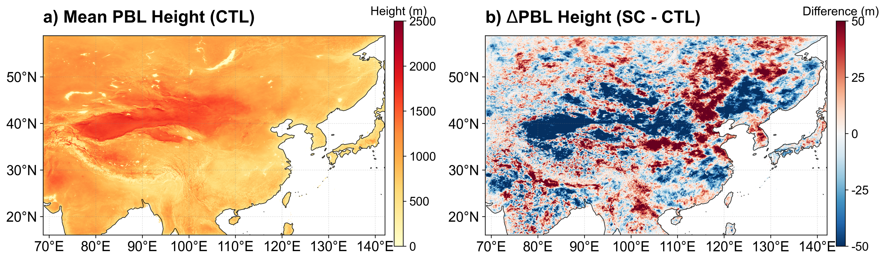
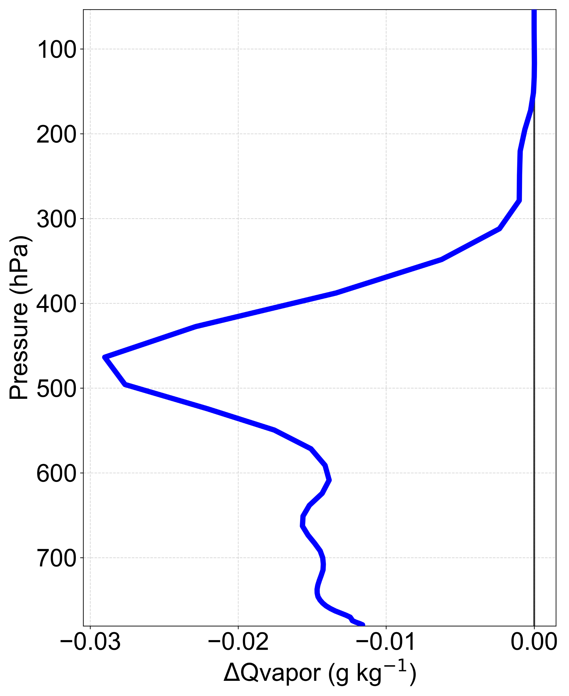

<!-- markdownlint-disable MD013 MD025 -->

# Supporting Information for "Nonlocal atmospheric response to satellite constrained soil albedo in Northwest China improves Downstream Climate simulations of North China" {-}

Jinyan Chen¹², Kai Li¹, Li Dan¹, Jiangfeng Wei³, Wei Pan¹, Fuqing Yang¹, Peng Zhou⁴, Liwen Xing¹, Long Zhao⁵, and Hui Zheng¹

¹Institute of Atmospheric Physics, Chinese Academy of Sciences, Beijing 100029, China

²University of Chinese Academy of Sciences, Beijing 101408, China

³School of Atmospheric Sciences, Nanjing University of Information Science and Technology, Nanjing, China

⁴Institute of Disaster Risk Science, Beijing Normal University, Beijing 100875, China

⁵School of Geographical Sciences, Southwest University, Chongqing 400715, China

Corresponding author: Hui Zheng (<hzheng_iap@outlook.com>)

# Contents {-}

- Figures S1 to S3

This supporting information provides additional diagnostic figures, and statistical evaluations that complement the main manuscript. These materials offer a comprehensive view of the land-surface forcing and the resulting atmospheric response across different vertical levels and spatial scales.
The data files included in this supplement primarily consist of:

- Model Parameters: Spatial distributions of the satellite-constrained soil albedo parameters (dry- and saturated- soil albedo) used in the SC experiment, along with the background soil moisture conditions (Figure S1).
- Boundary Layer and Vertical Structure: Diagnostic variables including the Planetary Boundary Layer (PBL) height (Figure S2) and vertical profiles of water vapor anomalies over the forcing region (Figure S3), which are essential for understanding the local-to-remote coupling

